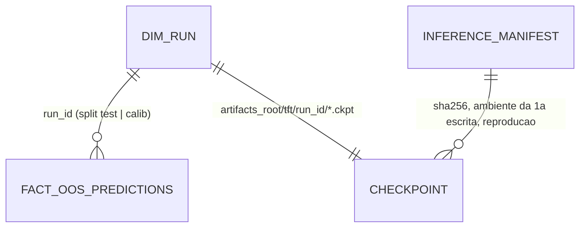

# Concept — Stage 7.1 — Motor de inferência

> **Escopo deste documento:** o que será feito nesta Stage, por quê, e
> decisões técnicas relevantes para entender o "porquê". O plano executável
> fica no [`technical.md`](./technical.md) correspondente.
>
> **Stage é a unidade de ciclo concept→technical→execução.** Sobre
> hierarquia (Step → Stage → Task) e critérios de atomicidade, ver
> [`PIPELINE.md`](../../PIPELINE.md) §4.
>
> **Status (apenas dois estados).** `draft` desde a criação; `done` após
> o gate humano. Regressão `done → draft` é **permitida** quando a
> Fase 3B (Technical) revela gap material aqui — neste caso, commit
> `chore(concept): revert to draft — revision-from-technical: <motivo>`.
> O Passo 8 do runbook (início da Fase 4) exige `concept.status == done`
> **e** `technical.status == done` simultaneamente.

## 1. Escopo

### Dentro do escopo

- **Resolução e predição a partir do checkpoint, no `modeling`** (ADR 7.1.0001):
  - port-out novo `CheckpointLocator` com adapter stdlib
    `modeling/adapters/out/filesystem/checkpoint_locator.py`
    (`FilesystemCheckpointLocator`: lista o diretório, exige um único `.ckpt`,
    calcula o sha256 por streaming — módulo sem import de torch/lightning/
    pytorch_forecasting, instanciado direto no composition root, fora do proxy
    lazy);
  - port-out novo `TftCheckpointPredictor` (um método,
    `predict_from_checkpoint`, implementado pelo `PfTftTrainer`): lê os bytes do
    arquivo **uma vez**, calcula o sha256 sobre esses bytes com a função de hash por streaming
    (stdlib) que mora no módulo do port `checkpoint_locator.py` — locator e
    trainer importam dali, sem import entre adapters (regra 3b do
    `check_layout.py`), confere com o esperado e carrega **dos mesmos bytes**
    (`io.BytesIO` — `load_from_checkpoint` aceita objeto de arquivo:
    lightning 2.6.5 `pytorch/core/saving.py` L55/L65 e
    `fabric/utilities/cloud_io.py` L51, "any sort of BytesIO"); reconstrói o dataset de predição
    com o `dataset_parameters` gravado no checkpoint — normalizador do alvo
    **e** scalers por covariável, já ajustados; emite pela **mesma** função
    `_emit` e pela **mesma** receita de dataset de predição que o
    `train_and_predict` usa para o teste — extraídas, não copiadas);
  - dois use cases novos, cada um satisfazendo um port do `inference` por duck
    typing: `ResolveTftCheckpoints` (confere declarações e completude do
    cohort, recalcula folds e `run_id`, localiza o checkpoint de cada fold —
    sem carregar) e `PredictTftFromCheckpoints` (recebe a lista permitida de
    `(run_id, sha256 esperado)` e só carrega o que está nela);
  - extração de helpers compartilhados, sem mudar valor persistido algum:
    identidade do run e diretório do artefato (`TrainTft._identity`), guarda de
    emissão fora do pedido (`_assert_emission_within_request`), conferência de
    declarações do cohort (`RunConfirmatoryCohort._check_declarations`) e
    construção `CohortSpec → TrainTftCommand` (o `tft(seed)` interno de
    `RunConfirmatoryCohort._units`).
- **Slice `inference` novo** (application + adapters):
  - ports do consumidor, cada um com fake e suíte de contrato `[fake, real]`:
    `CheckpointResolver` (real: `ResolveTftCheckpoints`),
    `CheckpointGridPredictor` (real: `PredictTftFromCheckpoints`),
    `RuntimeEnvironmentProbe` (real: `GitRuntimeEnvironmentProbe`),
    `PredictionPersister` (real: `PersistPredictions`), `SilverTableReader`
    (real: `ParquetAnalyticsRepository`), `CohortLedger` (lock de escritor e
    ambiente gravado; real: `JsonCohortProgressLedger`) e `InferenceManifest`
    (real: adapter JSON novo);
  - use case `RunInference` (fluxo em §5, I4–I8);
  - adapter `JsonInferenceManifest` (`adapters/out/filesystem/`);
  - comando de CLI `infer` (`adapters/in/cli/inference_commands.py`) carregado
    pelo `cli.py` da raiz, e o wiring no `composition_root.py`.
- **Correção no `analytics_store`/`modeling`:** `ParquetCohortRunIndex` passa a
  contar só linhas `split = "test"`; o docstring do port `CohortRunIndex` diz
  "linhas de teste"; o fake `InMemoryCohortRunIndex` ganha `split` e descarta o
  que não é teste (ADR 7.1.0002 item 4).
- **Gates:** contratos do `.importlinter` para o slice novo
  (`hexagonal-layers`, `inward-only`, `store-no-storage-leak`, contrato novo
  `inference-no-torch-leak` sobre `inference.application` e `inference.domain`
  — o mesmo perímetro do `modeling-no-torch-leak` —, `bc-independence` com as
  arestas de dados declaradas uma a uma) e o perímetro do LAYOUT §7.
- **Errata do ADR 5.4.0006** (scalers por covariável também são estado
  ajustado) — aplicada neste concept.
- **Emenda do roadmap** (feita neste concept): caminhos e contratos da 7.1, e os
  `contratos_consumidos` de 7.2/7.3/7.4/8.1 passam a nomear o que a 7.1 entrega.
- **Execução real sobre o cohort** `aapl_confirmatory` r0 (decisão do
  orquestrador, Checkpoint A): o `infer` roda sobre os 60 runs (10 seeds × 6
  folds), grava a `calib` e o manifesto, com a reprodução do teste em `strict`
  — **só predições, nenhuma métrica** (I13).

### Fora do escopo (explicitamente)

- **Conformal (CQR), cobertura, qualquer escore** — Stage 7.2. Esta Stage não
  calcula pinball, cobertura, largura nem nada que use o realizado.
- **Explicabilidade** (permutação, VSN, ablação) — Stage 7.3; ela predirá pelo
  mesmo port de predição (ou uma extensão dele) sob o ADR 7.1.0001.
- **API HTTP** — Stage 7.4; o que ela serve é decidido no concept dela.
- **Calib dos comparadores** (baselines, GBM) — o CQR é do candidato
  (doc de domínio inference §2.1, §4); emitir calib de comparador seria decisão
  nova.
- **MC dropout / incerteza epistêmica** — fora por decisão A2 (doc de domínio
  §3.2); não existe caminho de código.
- **Predição em GPU / outro device** — o cohort é `cpu`; device ≠ cpu é da 7.3.
- **Re-gravar o teste** — colide com a PK append-only; a reprodução compara em
  memória (ADR 7.1.0003).
- **Hash do checkpoint no momento do treino** (mudaria o 5.4/5.5 e o cohort já
  rodou) — a primeira inferência registra o sha256 e a reprodução do teste é a
  prova comportamental (ADR 7.1.0004, Negative).
- **Mudar o probe de ambiente** (ex.: incluir modelo de CPU ou scikit-learn nas
  chaves) — mudaria a foto que a retomada da 5.5 compara; scikit-learn e a
  capacidade de CPU do torch vão nas configurações de inferência do manifesto.

### Vínculo com o roadmap

Step 7 — *Inferência, conformal, explicabilidade e API*. A 7.1 entrega o objeto
sobre o qual o Step trabalha (doc de domínio inference §2.1): a grade do
candidato reproduzida a partir do artefato e, sobretudo, as predições de
`calib` que o CQR da 7.2 consome (requisito de fronteira A4, §3.4). Atende o
DoD do roadmap §Stage 7.1 (bit a bit no ambiente pinado, tolerância declarada
entre ambientes, dropout off, sem MC dropout, grade do teste e da calib por
fold/seed/horizonte, guardrail reusado sem mascarar degeneração). Os caminhos
de arquivo e os contratos foram refinados neste concept (ADR 7.1.0001; linha
de 2026-10-06 na tabela de mudanças do roadmap). Overview §3/§11 (eixo
comparativo conformal) e ASSUM-4/R-REPRO-1 (tolerância declarada).

## 2. Objetivo da Stage

Ao fechar a Stage, cada (fold, seed) do candidato TFT do cohort confirmatório
tem, em `fact_oos_predictions`, as predições da partição `calib` geradas a
partir do **mesmo** checkpoint, pela **mesma** receita de predição que gerou as
predições de teste, com a prova registrada de que essa receita reproduz o teste
gravado — bit a bit no ambiente do cohort, por tolerância declarada fora dele.

## 3. Contexto e premissas

### Contexto

- **O cohort está treinado.** A 5.5 gravou 60 runs `tft_quantile` (10 seeds ×
  6 folds) no silver, cada um com um checkpoint da melhor época em
  `<artifacts_root>/tft/<run_id>/` (exatamente um `.ckpt` por diretório,
  conferido em 2026-10-06) e o ambiente da primeira execução em
  `<artifacts_root>/cohorts/<cohort_id>/progress.json`.
- **Nenhum treinador emite `calib`.** Todos gravam só `split = "test"`; o
  concept 5.2 delegou a emissão do calib à inferência; o doc de domínio a tornou
  requisito (A4).
- **O checkpoint basta para reconstruir sem re-ajuste.** Verificado no código da
  biblioteca pinada (pytorch-forecasting 1.8.0, lido na imagem e conferido por
  verificador de contexto zerado em 2026-10-06): `from_dataset` grava
  `dataset.get_parameters()` em `dataset_parameters`, o checkpoint o salva
  (`on_save_checkpoint`), `get_parameters()` inclui o normalizador e os
  `scalers` ajustados, e o construtor do dataset não re-ajusta o que já está
  ajustado. `from_dataset(ds, …)` é literalmente `from_parameters(ds.get_parameters(), …)`.
- **A carga executa pickle.** `load_from_checkpoint` usa `weights_only=False`
  (lightning ≥ 2.6); qualquer conferência de identidade do artefato só protege
  se acontecer **antes** da carga — por isso a resolução é separada da
  predição (ADR 7.1.0004).
- **O treinador prediz o teste a partir do checkpoint recarregado**, com
  `batch_size = params.batch_size` (111 no cohort), `num_workers = 0`, CPU, o
  número de threads default do processo e o flag de algoritmos determinísticos
  de volta ao default do processo (`False`) depois do `fit`
  (`pf_tft_trainer.py`). No mesmo ambiente, a re-inferência pela mesma receita
  deve igualar bit a bit o `value_raw` do teste.
- **O índice de runs da 5.5 conta todas as linhas do run** (qualquer `split`)
  — achado desta sessão; o `verify` da 5.5 acusaria corrupção assim que
  existir calib. (O `run` da 5.5 já abortaria por `code.src` diferente depois de
  qualquer commit em `src/`; quem depende de fato do filtro é o `verify`.) O
  `SeriesAssembly` da avaliação já filtra `split == "test"`.
- **Finding da 5.4 escalado para cá** (technical 5.4 §7, Task 01): a imagem de
  runtime carrega a pilha de deep learning. Disposição: a inferência roda pela
  mesma CLI/imagem, então a pilha é legítima em runtime; `optuna` fica (o
  `sweep` é subcomando da mesma CLI). Nada a mudar (ADR 7.1.0001, Neutral).

### Premissas

- O ambiente atual (imagem `financial_forecasting-app:dev`) tem as mesmas
  versões de biblioteca, 6 threads e `x86_64/12` que o cohort gravou (lido em
  2026-10-06, só versões) — logo o modo esperado na execução real é `strict`.
  Se não for, a regra de modo decide (ADR 7.1.0003); a premissa não sustenta
  decisão nenhuma.
- O silver e os artefatos do cohort real estão no checkout principal
  (`data/cohorts/aapl/` como `data_root`, `artifacts/` como `artifacts_root`),
  fora do git; a worktree os aponta por `--data-root` e `Settings.artifacts_root`.

### Dependências

- `5.4-tft-trainer` (`done`): port `TftTrainer`, adapter `PfTftTrainer`
  (`_emit`, receita de dataset), `TrainTft` (identidade, diretório do artefato,
  `model_version = "tft_quantile"`), ADRs 5.4.0001–5.4.0006.
- `4.3-prediction-persister` (`done`): `PersistPredictions`,
  `MultiHorizonPredictionPersister` (dono do `target_timestamp`),
  `QuantileForecast.from_raw` (guardrail, ADR 4.3.0002).
- `5.5-confirmatory-retrain` (`done`, não listada em `depends_on` do roadmap mas
  consumida): `CohortSpec` congelado, `load_training_grid`, `grid_fingerprint`,
  `JsonCohortProgressLedger` (lock e ambiente), `GitRuntimeEnvironmentProbe`,
  `CohortRunIndex`/`ParquetCohortRunIndex`, `recorded_run_problems`, CLI do
  cohort.
- `5.1-walk-forward-harness` (`done`): `WalkForwardSplitter`, `FoldSplit.calib`
  (ADR 5.1.0002).
- Gate de domínio do Step 7 (#150, PR #152): doc de domínio inference §3.

## 4. Contratos

### Introduzidos

**Ports do `inference`** (`inference/application/ports/out/`, consumidor —
ADR 0.0.0053; DTOs do fornecedor cruzam como dados):

- **`CheckpointResolver`** (`checkpoint_resolver.py`; real
  `ResolveTftCheckpoints`) — `__call__(command: ResolveTftCheckpointsCommand)
  -> ResolveTftCheckpointsResult`. **Não carrega nenhum checkpoint.**
- **`CheckpointGridPredictor`** (`checkpoint_grid_predictor.py`; real
  `PredictTftFromCheckpoints`) — `__call__(command: PredictTftFromCheckpointsCommand)
  -> PredictTftFromCheckpointsResult`.
- **`RuntimeEnvironmentProbe`** (`runtime_environment_probe.py`; real
  `GitRuntimeEnvironmentProbe`) — `snapshot() -> Mapping[str, str]`, mesma
  forma do port homônimo do modeling.
- **`PredictionPersister`** (`prediction_persister.py`), **`SilverTableReader`**
  (`silver_table_reader.py`) — mesma forma dos homônimos de `modeling`
  (persister) e `evaluation` (leitor).
- **`CohortLedger`** (`cohort_ledger.py`) — `acquire_writer(*, break_stale: bool
  = False)`, `release_writer()`, `environment(cohort_id) -> Mapping[str, str] |
  None`; subconjunto exato do `CohortProgressLedger`.
- **`InferenceManifest`** (`inference_manifest.py`) — `recorded(cohort_id) ->
  Mapping[str, object] | None`, `record_run(cohort_id, run_id, entry:
  Mapping[str, object]) -> None` (merge por run: campos de primeira escrita
  nunca são sobrescritos — ADR 7.1.0004 item 3); real `JsonInferenceManifest`
  em `<data_root>/inference/<cohort_id>/manifest.json`.

**Use cases do `modeling`** (fornecedores):

```python
# modeling/application/use_cases/resolve_tft_checkpoints.py
@dataclass(frozen=True)
class ResolveTftCheckpointsCommand:
    spec: CohortSpec                    # congelado; senão CohortNotFrozenError
    seed: int                           # ∈ spec.seeds

@dataclass(frozen=True)
class CheckpointResolution:
    fold_index: int
    run_id: str
    model_version: str                  # "tft_quantile"
    checkpoint_path: str
    checkpoint_sha256: str              # streaming, sem unpickle

@dataclass(frozen=True)
class ResolveTftCheckpointsResult:
    cohort_id: str
    seed: int
    runs: tuple[CheckpointResolution, ...]   # um por fold, em ordem

# modeling/application/use_cases/predict_tft_from_checkpoints.py
@dataclass(frozen=True)
class PredictTftFromCheckpointsCommand:
    spec: CohortSpec
    seed: int
    allowed: Mapping[str, str]          # run_id -> sha256 esperado (lista permitida)
    partitions: tuple[str, ...]         # subconjunto não vazio de ("test", "calib")
    num_threads: int                    # o torch_threads gravado pelo cohort

@dataclass(frozen=True)
class CheckpointRunPrediction:
    run_id: str
    fold_index: int
    checkpoint_sha256: str              # dos bytes lidos uma vez, dos quais o modelo é carregado
    normalizer_center: float            # do target normalizer do checkpoint
    normalizer_scale: float
    grids: Mapping[str, Mapping[int, Mapping[int, tuple[float, ...]]]]
    # partição -> decision_idx -> horizonte -> grade CRUA alinhada a spec.quantile_levels

@dataclass(frozen=True)
class PredictTftFromCheckpointsResult:
    cohort_id: str
    seed: int
    dataset_timestamps: tuple[str, ...]     # grade de pregão do grid único
    settings: Mapping[str, str]             # batch_size, num_workers, accelerator,
                                            # num_threads, deterministic_algorithms,
                                            # cpu_capability, platform, scikit-learn
    runs: tuple[CheckpointRunPrediction, ...]
```

`ResolveTftCheckpoints`: C1, C2 e a completude do cohort (C14) antes de
qualquer outra coisa; `run_id` de cada fold pela função de identidade do
`TrainTft`; diretório pela mesma regra; `CheckpointLocator.locate` por fold.
`PredictTftFromCheckpoints`: mesmas conferências C1/C2; para cada fold, o
`run_id` derivado tem de estar em `allowed` (senão `UnknownRunError` sem
carregar); o adapter recalcula o sha256 e ergue `ArtifactChangedError` antes do
unpickle se divergir; emissão só dos pares pedidos (I12).

**Ports-out do `modeling`** (`modeling/application/ports/out/checkpoint_locator.py`,
real `FilesystemCheckpointLocator`, stdlib; `tft_checkpoint_predictor.py`, real
`PfTftTrainer`). O port `runtime_environment_probe.py` ganha a constante
`THREADS_KEY = "torch_threads"` (hoje literal no adapter), ao lado de
`CODE_KEYS`/`DIRTY_KEY`:

```python
@dataclass(frozen=True)
class CheckpointLocation:
    path: str
    sha256: str

@dataclass(frozen=True)
class TftCheckpointPrediction:
    grids: Mapping[int, GridByHorizon]       # decision_idx -> horizonte -> tupla crua
    normalizer_center: float
    normalizer_scale: float
    settings: Mapping[str, str]

class CheckpointLocator(Protocol):          # ports/out/checkpoint_locator.py
    def locate(self, *, artifact_dir: str) -> CheckpointLocation: ...

class TftCheckpointPredictor(Protocol):     # ports/out/tft_checkpoint_predictor.py
    def predict_from_checkpoint(
        self, *, checkpoint_path: str, expected_sha256: str,
        feature_names: Sequence[str], known_feature_names: Sequence[str],
        rows: Sequence[Sequence[float]], target: Sequence[float],
        decision_indices: Sequence[int], max_horizon: int, horizons: Sequence[int],
        quantile_levels: Sequence[float], batch_size: int, num_threads: int,
    ) -> TftCheckpointPrediction: ...
```

Contrato: `CheckpointLocator.locate` exige exatamente um `*.ckpt` (C3); seu
adapter real é stdlib (`hashlib`, `pathlib`) e o módulo não importa a pilha de
DL (teste em subprocesso: importar o módulo e chamar `locate` deixa `torch`
fora de `sys.modules`). `predict_from_checkpoint` lê os bytes uma vez, confere
o sha256 desses bytes e só então carrega deles (C10 — não há janela entre o
hash e o unpickle),
confere as entradas que o checkpoint declara (reais conhecidas/desconhecidas,
comprimento do decodificador, níveis da `QuantileLoss`) contra as passadas
(C4), prediz com `torch.set_num_threads(num_threads)` e
`torch.use_deterministic_algorithms(False)` (o estado em que o treinador emitiu
o teste), restaurando os dois depois; faixa de decisões contígua e crescente;
emissão pela regra I16 com o `_emit`; modo eval; mesma entrada ⇒ mesma saída,
independente do RNG global e do processo (A2).

**Use case do `inference`** (`inference/application/use_cases/run_inference.py`):

```python
@dataclass(frozen=True)
class RunInferenceCommand:
    spec: CohortSpec
    break_stale_lock: bool = False
    cross_environment_justification: str | None = None
    # força o modo tolerância; só aceito com texto não vazio (registrado). Ver I6.

@dataclass(frozen=True)
class InferenceRunOutcome:
    run_id: str
    fold_index: int
    seed: int
    reproduction_mode: str              # "strict" | "tolerance"
    test_values_compared: int
    max_abs_diff: float                 # em unidades do alvo
    max_normalized_diff: float          # |Δ| / normalizer_scale
    calib_rows_written: int
    calib_rows_verified: int

@dataclass(frozen=True)
class RunInferenceResult:
    cohort_id: str
    outcomes: tuple[InferenceRunOutcome, ...]
```

**Exceções** (inference, `ApplicationError`): `ReproductionError`,
`UnknownRunError`, `ArtifactChangedError`, `IncompleteCalibError`,
`InferenceEnvironmentError`, `CalibProvenanceMissingError`; (modeling)
`CheckpointNotFoundError`, `AmbiguousCheckpointError`,
`CheckpointMismatchError`, `IncompleteCohortError`. Nomes finais e hierarquia
na Fase 3B; `UnknownRunError`/`ArtifactChangedError` erguidos no modeling são
dele (o inference não os importa: propagam como `ApplicationError`).

**CLI** `python -m financial_forecasting.cli infer --data-root <dir> --cohort
<toml> [--break-stale-lock] [--cross-environment "<justificativa>"]`; saída por
run: modo, valores comparados, max |Δ|, max |Δ|/escala, linhas de calib
escritas e verificadas.

### Consumidos

- **`TftTrainer` / `PfTftTrainer`** (5.4) — `_emit`, receita do dataset de
  predição, `_panel_frame`; o artefato `<artifacts_root>/tft/<run_id>/*.ckpt`.
- **`TrainTft`** (5.4) — identidade do run (`ConfigSignature` + `RunId`, nove
  slots), `MODEL_VERSION`, regra do diretório do artefato, tipagem
  known/unknown.
- **`CohortSpec`, `load_training_grid`, `grid_fingerprint`,
  `recorded_run_problems`, `CohortRunIndex`, exceções de declaração,
  `JsonCohortProgressLedger`, `GitRuntimeEnvironmentProbe`** (5.5).
- **`WalkForwardSplitter`, `FoldSplit.calib`** (5.1, ADR 5.1.0002).
- **`PersistPredictions`, `PersistPredictionsCommand`, `QuantileForecast.from_raw`**
  (4.3, ADRs 4.3.0001/4.3.0002).
- **`ParquetAnalyticsRepository.read`** (4.2) — `dim_run` e `fact_oos_predictions`.
- **`Clock`, `Hasher`, `CohortHash`** (shared).

## 5. Invariantes e regras

Fluxo do `RunInference`: (0) antes de lock e probe, como na 5.5
(`run_confirmatory_cohort.py` L305–316): `spec.is_frozen()` (C1) e validação do
comando (C13); depois, por seed: (a) lock adquirido; (b) ambiente atual pelo
probe — `code_dirty = "true"` ou ambiente do cohort ausente ⇒ erro (C11);
(c) `CheckpointResolver` (sem carga, inclui completude do cohort); (d) para
cada fold: run no `dim_run` (C6) e sha256 contra o manifesto (C10); (e)
`CheckpointGridPredictor` com a lista permitida; (f) por run: reprodução do
teste → entrada write-ahead no manifesto → calib → contagem relida → entrada
concluída. Lock liberado em `finally`.

- **I1 — uma receita de predição.** O dataset de predição do teste no treino e
  o do teste/calib na inferência saem do **mesmo** helper (via
  `from_parameters` com os parâmetros ajustados do treino) e a grade sai do
  **mesmo** `_emit`. Não existe segunda implementação de corte de quadro, piso
  de decisão, `min_prediction_length`, recorte por `decoder_lengths` nem
  escolha de janela (ADR 7.1.0001).
- **I2 — torch só no modeling.** Nenhum módulo de `inference.application` ou
  `inference.domain` importa `torch`, `lightning` ou `pytorch_forecasting`
  (contrato `inference-no-torch-leak`); nesta Stage nem os adapters do
  `inference` o fazem.
- **I3 — nada é re-ajustado.** O dataset de predição herda normalizador e
  scalers do checkpoint; nenhum `fit` acontece na inferência (ADR 5.4.0001
  cláusula 2; errata do ADR 5.4.0006).
- **I4 — nada é carregado antes das guardas.** Antes de qualquer unpickle:
  ambiente atual limpo (C11), cohort completo (C14), `run_id` no `dim_run` do
  cohort com fold/seed/`model_version` esperados (C6), sha256 igual ao do
  manifesto quando houver (C10) e igual ao dos bytes lidos uma vez pelo
  adapter, dos quais o modelo é carregado (C10). As linhas de calib herdam `run_id`,
  `model_version`, `asset`, `feature_set_name` e `schema_version` do run de
  treino.
- **I5 — reprodução antes da emissão.** Para cada run, o teste re-predito é
  comparado com o `value_raw` do teste no silver, no mesmo conjunto de chaves
  `(decision_idx, horizonte, nível)`, em float64 sobre valores que são float32
  representáveis; `strict` = igualdade exata; `tolerance` =
  `|Δ| / s ≤ 1e-5 + 1,3e-6·|(ref − c) / s|` com `c`, `s` = centro e escala do
  normalizador do checkpoint — a regra do `assert_close` aplicada a
  `z = (y − c)/s`, o espaço onde a rede computa. Falha ergue antes de
  qualquer linha de calib do run (ADR 7.1.0003).
- **I6 — modo.** `strict` quando o ambiente de referência é igual ao atual em
  toda chave que não é de código; senão `tolerance`. Referência do teste = o
  ambiente gravado pelo cohort; referência do calib já presente = o ambiente da
  primeira escrita de calib daquele run (manifesto). As chaves de código e as
  de reprodução **não são redeclaradas**: o `inference` importa `CODE_KEYS`,
  `DIRTY_KEY` e `THREADS_KEY` do port `runtime_environment_probe` do modeling
  (aresta de dados declarada no `bc-independence`). `--cross-environment` só
  muda algo quando as chaves não-código são iguais (com chave diferente o modo
  já é `tolerance`); seu **único uso legítimo** é uma diferença numérica
  diagnosticada que as chaves não capturam (ex.: capacidade de CPU), e a
  justificativa tem de citar o `[finding]` desse diagnóstico (formato checado:
  contém `[finding]`); grava `forced = true` no manifesto e vale para teste e
  calib. Uma falha de `strict` não diagnosticada é parada (`[finding]`), nunca
  `--cross-environment`.
- **I7 — parâmetros de inferência fixos por construção:** lote =
  `spec.tft_params.batch_size`, `num_workers = 0`, `accelerator = "cpu"`, um
  device, modo eval, sem MC dropout, threads = `torch_threads` gravado pelo
  cohort, `use_deterministic_algorithms(False)` durante a predição (restaurados
  depois). Registrados no manifesto, com `torch.backends.cpu.get_cpu_capability()`,
  plataforma, versão do scikit-learn e `normalizer_center` e `normalizer_scale`
  por run.
- **I8 — calib completo, idempotente e com proveniência write-ahead.** Antes da
  primeira escrita de calib de um run, a entrada do run no manifesto é gravada
  com status `started`, sha256 e o ambiente atual (campo de primeira escrita);
  depois, por decisão de `calib`: escrita se ausente; se presente, a **linha
  inteira** é verificada — `value_raw` e `value_guardrail` sob o modo de I6;
  `guardrail_applied` por igualdade só em `strict` (em `tolerance` dois quantis
  quase empatados podem cruzar ou não dentro da tolerância, e o
  `value_guardrail` sob tolerância já cobre o efeito); `model_version`, `asset`,
  `feature_set_name`, `schema_version`, `timestamp_utc`, `target_timestamp_utc`
  sempre por igualdade. Uma entrada `started` só é **retomada** com ambiente
  não-código igual ao da 1ª escrita; senão `InferenceEnvironmentError` orientando
  a retomar no ambiente original (assim todas as linhas de um run nascem num só
  ambiente, o registrado). Ao
  fim, o silver é **relido** e as linhas de calib do run =
  `calib_size × |horizons| × |níveis|`; só então status `completed`. Linhas de
  calib presentes sem entrada no manifesto ⇒ `CalibProvenanceMissingError`
  (não se verifica sem saber em que ambiente nasceram). Rodar de novo escreve
  zero linhas e re-prova a igualdade; o ambiente da primeira escrita é
  preservado (ADR 7.1.0002, 7.1.0004).
- **I9 — guardrail reusado sem mascarar degeneração.** O calib passa por
  `QuantileForecast.from_raw` (rearranjo do ADR 4.3.0002); `value_raw` e
  `value_guardrail` ficam na mesma linha, e a degeneração continua detectável
  pelo gate separado do Step 6.
- **I10 — o índice do cohort conta só teste.** `ParquetCohortRunIndex` e o fake
  ignoram linhas com `split ≠ "test"`; o `verify` da 5.5 fica idêntico antes e
  depois da inferência.
- **I11 — escritor único.** `RunInference` detém o lock de escritor do
  `data_root` do início ao fim (liberado em `finally`).
- **I12 — partições e horizontes do pedido.** Nenhuma grade de decisão fora da
  partição pedida nem de horizonte fora de `spec.horizons` sai do modeling
  (guarda de emissão generalizada da 5.4 D5).
- **I13 — cegamento: só predições.** Nenhum componente desta Stage lê o
  realizado para avaliar nem calcula escore, cobertura, largura ou qualquer
  função de predição × realizado. O `target` entra no quadro só como entrada do
  codificador; a reprodução compara predição com predição (doc de domínio
  inference §7; evaluation §8.2; ADR 5.5.0001). O `inference` não importa
  `evaluation`.

## 6. Casos de erro e exceções

| # | Situação | Comportamento |
|---|---|---|
| C1 | spec não congelado | `CohortNotFrozenError` antes de qualquer I/O |
| C2 | fingerprint do grid, `feature_set_hash`, `pipeline_version` ou device ≠ declarados | `DatasetMismatchError` / `CohortDeclarationMismatchError` (as da 5.5, pela função compartilhada), antes de localizar checkpoint |
| C3 | diretório do run sem `.ckpt` ou com mais de um | `CheckpointNotFoundError` / `AmbiguousCheckpointError`, nomeando o diretório |
| C4 | checkpoint declara reais, decodificador ou níveis diferentes dos do chamador; faixa de decisões não contígua | `CheckpointMismatchError` / `ValueError` |
| C5 | falha da biblioteca ao carregar/predizer | `ModelTrainingError` com a original em `__cause__` (vocabulário enumerado da 5.4, issue #84) |
| C6 | `run_id` resolvido ausente do `dim_run` do cohort, com fold/seed/`model_version` diferentes, ou fora da lista permitida | `UnknownRunError`, sem carregar |
| C7 | teste re-predito com chaves diferentes das do silver, ou valor fora do critério do modo | `ReproductionError` (run, modo, nº de valores, max \|Δ\|, max \|Δ\|/s); nada do calib do run é escrito; o processo para |
| C8 | linha de calib presente diferente da re-predita (qualquer campo) | `ReproductionError`; nada é escrito |
| C9 | calib do run incompleto na releitura | `IncompleteCalibError` (status fica `started`) |
| C10 | sha256 ≠ o do manifesto, ou ≠ o esperado sobre os bytes lidos para a carga | `ArtifactChangedError`, sem carregar |
| C11 | ambiente do cohort não gravado, `code_dirty = "true"` no probe atual, ou retomada de entrada `started` em ambiente não-código diferente do da 1ª escrita | `InferenceEnvironmentError` (antes de resolver; no último caso, antes de escrever) |
| C12 | lock de escritor já detido | `CohortRunLockedError` (da 5.5) propaga sem ser importado pelo `inference` (a CLI trata `ApplicationError`) |
| C13 | `seed ∉ spec.seeds`, partição fora de `{test, calib}`, `--cross-environment` com justificativa vazia ou sem `[finding]` | `ValueError` antes de lock, probe ou qualquer I/O |
| C14 | cohort incompleto (regra `recorded_run_problems` sobre as unidades TFT) | `IncompleteCohortError` antes de localizar checkpoint |
| C15 | calib presente sem entrada do run no manifesto | `CalibProvenanceMissingError` |

A CLI traduz `ApplicationError`/`DomainError` em mensagem e código de saída 2,
como os comandos da 5.5.

## 7. Decisões técnicas relevantes

> Bifurcações triadas (PROMPT-step §2 + `evidence-resolution`): todas E/C ou
> respondidas pelos docs; nenhuma P. Registro das E/C no ADR 7.1.0003 §Decision
> record; trechos de biblioteca conferidos por verificador de contexto zerado
> em 2026-10-06. Checkpoint A rodada 1 (2026-10-06) incorporado.

### D1 — Onde mora a predição a partir do checkpoint (fork 1)
- **O quê:** ports do consumidor `CheckpointResolver` e `CheckpointGridPredictor`
  no `inference`, satisfeitos pelos use cases `ResolveTftCheckpoints` e
  `PredictTftFromCheckpoints` do `modeling`, que chamam os ports-out novos
  `CheckpointLocator` (adapter stdlib, sem pilha de DL) e
  `TftCheckpointPredictor` (`predict_from_checkpoint`, implementado pelo
  `PfTftTrainer` com o mesmo helper de dataset e o mesmo `_emit`). Resolução e predição separadas para que as guardas aconteçam antes
  da carga (D5).
- **Por quê:** ADR 0.0.0053 item 2 e Consequences; precedente
  `ReadTrainingGrid` → `TrainingGridReader` (ADR 6.4.0009); ADR 5.5.0004 (uma
  fonte só); `modeling-no-torch-leak`; anti-padrão "dois pipelines" (skill
  `dmls-ch06`, Task 1).
- **Fonte:** ADRs citados; `pf_tft_trainer.py`; issue #153 Passo 1b item 5.
- **ADR:** [`7.1.0001`](../../adr/7_1_0001-checkpoint-prediction-supplied-by-modeling-through-consumer-port.md)

### D2 — Reconstrução pelo `dataset_parameters` do checkpoint
- **O quê:** dataset de predição = `from_parameters(model.dataset_parameters,
  quadro_recortado, min_prediction_idx=min(decisões)+1, min_prediction_length=1,
  stop_randomization=True)`; o treino passa a usar o mesmo helper com
  `training.get_parameters()` (equivalente literal do `from_dataset` atual).
- **Por quê:** o artefato é a referência (doc de domínio §3.1); re-ajustar
  esconderia divergência entre checkpoint e código (ADR 7.1.0001 Alt. D).
- **Fonte:** pytorch-forecasting 1.8.0 `_timeseries.py` L1623–1745,
  `_base_model.py` L1535–1590.
- **ADR:** 7.1.0001.

### D3 — Calib em `fact_oos_predictions`, complementação idempotente, índice só de teste (fork 2)
- **O quê:** `split = "calib"` sob o `run_id` do treino, via `PersistPredictions`,
  sem DDL; por decisão, escreve se ausente e verifica a linha inteira se
  presente; contagem relida do silver; índice do cohort (real e fake) só de
  teste.
- **Por quê:** ADR 4.1.0002; ADR 5.1.0002; escrita por decisão é atômica e a
  predição é determinística; o `verify` contaria o calib como corrupção.
- **Fonte:** ADRs citados; `parquet_cohort_run_index.py`;
  `recorded_run_problems`; `series_assembly.py` L155.
- **ADR:** [`7.1.0002`](../../adr/7_1_0002-calib-predictions-in-fact-oos-predictions-idempotent-completion.md)

### D4 — Contrato de reprodução, modo e tolerância (fork 3)
- **O quê:** referência = `value_raw` do teste no silver, em memória; `strict`
  com ambiente igual nas chaves não-código; senão tolerância float32 do
  `assert_close` aplicada **no espaço normalizado** (÷ escala do normalizador
  do checkpoint); threads e flag determinístico fixados aos valores do treino.
- **Por quê:** A1 (E) e A1-TOL (C); a rede computa em float32 no espaço
  normalizado (z ~ O(1)), onde o par (1,3e-6, 1e-5) do default float32 tem a
  escala para a qual foi pensado; em unidades de retorno (O(1e-2)) o `atol`
  1e-5 seria ~1e-3 relativo — frouxo demais (achado A-D3 do Checkpoint A).
  Fixar threads/flag nos valores do treino fecha a lacuna do doc §3.1 sem mudar
  a numérica que se reproduz.
- **Fonte:** doc de domínio §3.1–§3.2, §10.1; `progress.json` do cohort;
  `torch/testing/_comparison.py`.
- **ADR:** [`7.1.0003`](../../adr/7_1_0003-reproduction-contract-strict-same-environment-tolerance-across.md)

### D5 — Resolução antes da carga, manifesto write-ahead e lock (fork 4 e registro de parâmetros)
- **O quê:** `run_id → .ckpt` por regra com exatamente um arquivo; sha256 por
  streaming na resolução e de novo sobre os bytes lidos uma vez, dos quais o
  modelo é carregado (`io.BytesIO`); lista
  permitida `(run_id, sha256)` passada à predição; manifesto JSON por cohort em
  `<data_root>/inference/<cohort_id>/manifest.json`, entrada por run gravada
  antes da primeira escrita de calib e mesclada (campos de primeira escrita
  imutáveis); lock de escritor do `data_root`.
- **Por quê:** concept 5.4 D9; ADR 1.5.0002; `weights_only=False` exige a
  conferência antes da carga; Sandve et al. 2013 Regra 1; ADR 5.5.0003 (JSON
  atômico, lock); o manifesto descreve o silver de um `data_root` e fica junto
  dele.
- **Fonte:** concept 5.4 D9; ADRs 1.5.0002, 5.5.0003; `json_cohort_progress_ledger.py`.
- **ADR:** [`7.1.0004`](../../adr/7_1_0004-checkpoint-resolution-before-load-and-write-ahead-inference-manifest.md)

### D6 — Errata do ADR 5.4.0006 (fork 5)
- **O quê:** errata datada: os scalers por covariável também são estado
  ajustado no treino, herdado sem re-ajuste e gravado no `dataset_parameters`.
- **Por quê:** convenção de errata existente (ADRs 0.0.0053, 1.4.0001, 6.2.0002).
- **Fonte:** `_timeseries.py` L1256–1268; issue #153 Passo 1b.
- **ADR:** errata no próprio [`5.4.0006`](../../adr/5_4_0006-explicit-train-fitted-target-normalizer.md).

### D7 — Cegamento como invariante (fork 6)
- **O quê:** I13 — a Stage gera predições, não métricas; a execução real
  sobre o r0 é permitida porque não calcula nada sobre o realizado.
- **Por quê:** doc de domínio inference §7; evaluation §8.2.
- **Fonte:** citadas. Sem alternativa real (não vira ADR).

### D8 — Superfície de runtime: subcomando `infer` da CLI (fork 7)
- **O quê:** `infer` no `cli.py` da raiz, implementação em
  `inference/adapters/in/cli/inference_commands.py` (`importlib`, LAYOUT §8); o
  `cli.py` lê o TOML do cohort com o leitor da 5.5 e passa o `CohortSpec`.
- **Por quê:** concept 5.4 §1 atribuiu a superfície de runtime à 7.1; a CLI da
  5.5 é o precedente.
- **ADR:** 7.1.0001 (item 5, Alternativa E).

### D9 — Paradigma de serving e o que os consumidores recebem
- **O quê:** a inferência é um job em lote sobre o cohort congelado. O que a 7.1
  entrega aos vizinhos: linhas `split = "calib"` + manifesto (7.2, 8.3); os
  ports de resolução e predição do modeling (7.3, 7.4); o `infer` idempotente
  (8.1). `RunInference` devolve contagens, não grades — os
  `contratos_consumidos` de 7.2/7.3/7.4/8.1 no roadmap foram emendados para
  isso (linha no changelog).
- **Por quê:** o consumidor de 7.2/8.1 precisa de partições inteiras
  persistidas (skill `dmls-ch06`, Task 1); prometer `RunInference` a quem precisa
  de grades seria contrato falso (achado A-C5).
- **Fonte:** roadmap §7.2–§8.1.

## 8. Integrações

### Internas (com outras Stages/módulos)

- **modeling** (fornecedor): use cases `ResolveTftCheckpoints` e
  `PredictTftFromCheckpoints`, port-out e adapter de checkpoint, helpers
  extraídos de `TrainTft` e `RunConfirmatoryCohort`;
  `GitRuntimeEnvironmentProbe` satisfaz `RuntimeEnvironmentProbe` e
  `JsonCohortProgressLedger` satisfaz `CohortLedger` (wiring só no composition
  root).
- **analytics_store** (fornecedor): `PersistPredictions` satisfaz
  `PredictionPersister`; `ParquetAnalyticsRepository` satisfaz
  `SilverTableReader`; `ParquetCohortRunIndex` corrigido (I10).
- **evaluation**: nada muda; teste de regressão prova que `SeriesAssembly`/
  `RefreshGold` dão o mesmo resultado com e sem linhas de calib.
- **7.2** consome as linhas `split = "calib"` por `run_id` e o manifesto;
  **7.3/7.4** os ports de predição; **8.1** reexecuta `infer` como verificação
  idempotente; **8.3** cita o manifesto no dossiê.
- **Arestas de dados novas** no `bc-independence` (uma a uma):
  `inference.application → modeling.application` (DTOs dos dois use cases,
  `CohortSpec` e as constantes `CODE_KEYS`/`DIRTY_KEY`/`THREADS_KEY` do port
  `runtime_environment_probe` — importadas, nunca redeclaradas),
  `inference.application → analytics_store`
  (`PersistPredictionsCommand`, `QuantileForecast`). Nenhuma de comportamento.

### Externas

- **pytorch-forecasting 1.8.0 / lightning 2.6.5 / torch 2.13.0+cpu** — só no
  adapter do modeling: `TemporalFusionTransformer.load_from_checkpoint`,
  `TimeSeriesDataSet.from_parameters`, `model.predict(mode="quantiles",
  return_index=True, return_decoder_lengths=True, batch_size, num_workers=0,
  trainer_kwargs=…)`, `torch.set_num_threads`,
  `torch.use_deterministic_algorithms`, `torch.backends.cpu.get_cpu_capability`.
- **Sistema de arquivos** — listagem e sha256 por streaming do checkpoint;
  manifesto com temporário + `os.replace`.

## 9. Modelo de dados

Nenhuma tabela ou coluna nova. Linhas novas em `silver.fact_oos_predictions`
(schema v1, inalterado):

| coluna | valor nas linhas de calib |
|---|---|
| `run_id`, `model_version`, `asset`, `feature_set_name`, `schema_version` | os do run de treino (`tft_quantile`) |
| `split` | `"calib"` |
| `decision_idx`, `timestamp_utc`, `target_timestamp_utc`, `year` | resolvidos pelo `MultiHorizonPredictionPersister` (4.3) |
| `horizon`, `quantile_level` | `spec.horizons` × `spec.quantile_levels` |
| `value_raw`, `value_guardrail`, `guardrail_applied` | grade crua e rearranjada (`QuantileForecast.from_raw`) |

Volume no cohort real: 60 runs × 252 decisões × 2 horizontes × 7 níveis =
211.680 linhas. Manifesto: um JSON por cohort no `data_root`, fora do silver.



## 10. Riscos e mitigações

| Risco | Probabilidade | Impacto | Mitigação |
|---|---|---|---|
| `strict` falha com chaves não-código iguais (modelo de CPU, kernel) | B | A | Parada para diagnóstico (`[finding]`); `--cross-environment` só depois, citando o `[finding]` e gravando `forced = true`; capacidade de CPU do torch registrada; teste de adapter em subprocesso prova a igualdade entre processos |
| Run iniciado num ambiente e retomado noutro | B | M | Retomada de entrada `started` exige ambiente não-código igual ao da 1ª escrita (C11) |
| Refatorar helpers muda o teste já gravado | B | A | Golden da 5.4 e de identidade verdes byte a byte; a reprodução no cohort real detecta qualquer desvio |
| Escrita do calib corrompe o silver real (append-only, sem delete) | B | A | Cópia do `data_root` antes da 1ª execução real; verificação da linha inteira do que existe; lock; I10 antes da primeira escrita |
| Queda no meio de um run deixa calib sem proveniência | M | M | Manifesto write-ahead (I8); calib presente sem entrada ergue C15 em vez de ser verificado às cegas |
| `verify` da 5.5 acusa corrupção após o calib | A sem I10 | A | I10 + teste: `recorded_run_problems` idêntico antes e depois |
| Carga com `weights_only=False` executa código de artefato adulterado | B | A | Só runs do `dim_run`; sha256 conferido antes do unpickle e contra o manifesto (I4) |
| scikit-learn muda sem mudar as chaves do probe → `strict` falha | B | B | Versão no manifesto e na mensagem; falha alta, não silenciosa |
| Concorrência `infer` × `run` no mesmo `data_root` | B | A | Lock de escritor único (I11) |
| Vazamento de torch para a application do `inference` | B | M | `inference-no-torch-leak` provado por quebra intencional revertida |
| Cegamento violado por "sonda" de qualidade do calib | B | A | I13; nenhum import de `evaluation`; critérios só sobre igualdade e contagens |

## 11. Critérios de aceitação

- [ ] **Adapter (modeling, `[fake, real]` + reprodução):** num painel sintético
      pequeno, `predict_from_checkpoint` sobre as decisões de teste devolve
      exatamente (`==`) as grades do `train_and_predict` do mesmo fold; duas
      chamadas com estados de RNG global diferentes devolvem grades idênticas;
      a mesma predição num **subprocesso** devolve grades idênticas às do
      processo pai; com as decisões de `calib`, uma entrada por decisão e
      horizonte pedidos; `FilesystemCheckpointLocator.locate` com zero e dois
      `.ckpt` ergue C3, e importar o módulo do locator e chamar `locate` num
      subprocesso deixa `torch`, `lightning` e `pytorch_forecasting` fora de
      `sys.modules`; sha256 esperado errado ergue C10 **sem** chamar a carga
      (spy no carregador), e a carga recebe os mesmos bytes que foram hasheados
      (spy: objeto de arquivo, não caminho); checkpoint com
      níveis ou reais diferentes ergue C4; threads e flag determinístico
      restaurados depois da chamada. A mutação "modelo em modo treino" faz o
      teste de RNG falhar (registrada no §7 do technical).
- [ ] **Sem duplicação (teste):** spy no helper de dataset de predição e no
      `_emit` prova que `train_and_predict` e `predict_from_checkpoint` passam
      pelos mesmos objetos; o golden `test_tft_trainer_golden.py` e o golden de
      identidade da 5.4 continuam verdes sem atualização; o `run_id` e o
      `TrainTftCommand` do cohort saem das funções compartilhadas (teste
      cruzado com o `RunConfirmatoryCohort`).
- [ ] **Use cases do modeling** com fakes: `run_id` de cada fold igual ao que o
      `TrainTft` grava; decisões de `calib` = sessões de `FoldSplit.calib`; C1,
      C2, C13, C14 erguem antes de `CheckpointLocator.locate`; `run_id` fora da lista
      permitida ergue sem carregar; emissão fora do pedido ergue (I12);
      `model_version` presente na resolução.
- [ ] **`RunInference`** com fakes:
      - modo `strict` com ambientes iguais; `tolerance` com uma chave de
        biblioteca diferente; `--cross-environment` com chaves iguais e
        justificativa citando `[finding]` dá `tolerance` com `forced = true` no
        manifesto; chave de código diferente não muda o modo; justificativa
        vazia ou sem `[finding]` ergue C13 antes de lock e probe; spec não
        congelado ergue C1 antes de lock e probe;
      - entrada `started` retomada com ambiente não-código diferente do da 1ª
        escrita ergue C11 sem escrever; retomada no mesmo ambiente completa;
      - em `tolerance`, calib presente com `guardrail_applied` diferente (quase
        empate cruzado dentro da tolerância) passa; em `strict`, ergue C8;
      - valor 1 ulp float32 diferente reprova em `strict` e passa em
        `tolerance`; |Δ|/s acima da tolerância reprova; reprovação não escreve
        calib;
      - guardas na ordem: `code_dirty`, ambiente ausente, cohort incompleto,
        run fora do `dim_run`, sha256 divergente do manifesto — cada uma ergue
        **sem** chamar o predictor;
      - entrada write-ahead gravada antes da 1ª escrita de calib; queda
        simulada entre decisões → rerun completa só as ausentes e preserva o
        ambiente da 1ª escrita; calib parcial **sem** entrada no manifesto ergue
        C15; calib presente com um campo não-valor divergente ergue C8;
      - grade crua cruzada (não monótona) é gravada com `value_raw` original,
        `value_guardrail` monótono e `guardrail_applied = 1`;
      - contagem final relida = `calib_size × |H| × |níveis|`; segunda execução
        escreve 0 e verifica tudo; lock liberado também em erro; manifesto com
        modo, max |Δ|, max |Δ|/s, sha256, configurações (threads,
        capacidade de CPU, scikit-learn), centro e escala do normalizador,
        `forced` e ambientes.
- [ ] **Índice do cohort (I10):** com linhas de `calib`, `ParquetCohortRunIndex`
      e `InMemoryCohortRunIndex` devolvem as mesmas contagens e alvos que sem
      elas (suíte `[fake, real]`).
- [ ] **Avaliação intocada:** `SeriesAssembly`/`RefreshGold` sobre silver
      sintético dão resultado idêntico com e sem linhas `split = "calib"`
      (teste de regressão).
- [ ] **Ports do inference:** fake em `tests/fakes/features/inference/` e suíte
      `[fake, real]` para os sete; `check_port_coverage.py` verde sem entrada
      nova no baseline.
- [ ] **Integração ponta a ponta** (`tests/integration/features/inference/test_run_inference.py`,
      dado sintético, TFT real minúsculo): cohort congelado → `run` (5.5) →
      `infer` pela CLI (`main(argv, wiring=CliWiring(runtime_probe_factory=…))`,
      o ponto de injeção que o e2e da 5.5 já usa, com um probe fake de snapshot
      fixo e `code_dirty = "false"`; o probe real fica coberto pela suíte de
      contrato existente `test_runtime_environment_probe_contract.py`) → reprodução `strict` com max |Δ| = 0 em todos os runs;
      linhas de calib = esperado por run, `split = "calib"`, e `run_id`,
      `model_version`, `asset`, `feature_set_name`, `schema_version` iguais aos
      do teste do mesmo run; `value_guardrail` monótono; `verify` da 5.5 verde
      depois; segunda execução escreve 0; manifesto presente e completo.
- [ ] **Gates:** `lint-imports` verde com os contratos novos
      (`inference-no-torch-leak` provado por `import torch` intencional em
      `inference.application` → quebrado → revertido, saída no §7 do
      technical); `bc-independence` com o `inference` e as arestas de dados
      comentadas; `check_layout` verde; LAYOUT §7 lista seis slices.
- [ ] **Execução real** (sem métrica), sobre `aapl_confirmatory` r0 com
      `--data-root data/cohorts/aapl`, depois de copiar o `data_root`: com as
      chaves não-código iguais às gravadas, os **60 runs em `strict` com max
      |Δ| = 0**; 211.680 linhas de calib; `verify` verde; segunda execução
      escreve 0 linhas; nenhum módulo de `evaluation` importado ou executado
      (saída literal no §7 do technical). Falha de `strict` com chaves iguais =
      parada e `[finding]`, nunca `--cross-environment`.
- [ ] Roadmap §7.1 e `contratos_consumidos` de 7.2/7.3/7.4/8.1 emendados (feito
      neste concept) e 7.1 marcada `done` no fechamento; errata do ADR 5.4.0006
      presente.
- [ ] `make check` verde (gate de saída).

## 12. Checklist de validação interna

- [x] Todos os contratos introduzidos têm assinatura definida? — §4; nomes
      finais das exceções e o layout exato do JSON do manifesto fecham na Fase
      3B sem mudar a semântica (ADR 7.1.0004 item 3 lista o conteúdo).
- [x] Toda decisão em §7 tem fonte rastreável? — cada D cita ADR, doc de
      domínio, código ou fonte de biblioteca lida na versão pinada.
- [x] Toda integração externa tem contrato definido (interface, formato, auth)?
      — pytorch-forecasting/lightning/torch só no adapter do modeling, com as
      chamadas listadas em §8; sistema de arquivos com escrita atômica; sem
      autenticação.
- [x] Decisões com alternativa real descartada têm ADR escrito? — ADRs
      7.1.0001–7.1.0004 (`accepted`); D6 é errata de ADR existente; D7 e D9 sem
      alternativa real.
- [x] Dependências de Stages anteriores estão satisfeitas (`done`)? — 5.4, 4.3,
      5.5, 5.1 em `develop`; gate de domínio #150 mergeado (PR #152).
- [x] Stage cabe em ~3–12 Tasks (ver [`CONVENTIONS.md`](../../CONVENTIONS.md) §6)? — estimativa 11: (1) índice do cohort só de teste (port, real, fake) + regressão da avaliação; (2) extração dos helpers compartilhados de `TrainTft` e `RunConfirmatoryCohort`; (3) ports `CheckpointLocator` e `TftCheckpointPredictor` + fakes + adapter stdlib `FilesystemCheckpointLocator` + contrato do locator; (4) `PfTftTrainer.predict_from_checkpoint` (bytes lidos uma vez, helper de dataset compartilhado) + testes de reprodução + proxy lazy; (5) `ResolveTftCheckpoints` e `PredictTftFromCheckpoints`; (6) slice `inference`: sete ports + fakes + `.importlinter` + LAYOUT; (7) suítes `[fake, real]` dos ports com real existente; (8) `RunInference`; (9) `JsonInferenceManifest` + contrato; (10) wiring + CLI `infer`; (11) integração ponta a ponta. A execução real é verificação do gate de saída, não Task.
- [x] Riscos críticos têm mitigação plausível? — §10.
- [x] Cada mecanismo novo passou pelo **teste da solução mais direta**: não é caso especial/tipo/métrica novo remendando, local, um sintoma que recorre em outros consumidores e teria tratamento mais simples/geral em outra camada (concern compartilhado). Captura assim → piso declarado + issue, não solução local. — A predição não ganha implementação própria no `inference`: reusa a receita de dataset e o `_emit` do treinador (dono único, no adapter do modeling), e a identidade do run, a conferência de declarações e o comando de treino saem das mesmas funções do modeling, extraídas em vez de recalculadas; o guardrail é o `QuantileForecast.from_raw` existente; a persistência é o `PersistPredictions` (dono único do `target_timestamp`) na tabela existente, sem DDL; o índice do cohort contando calib é corrigido na origem (adapter, port e fake do índice), não contornado com filtro no `inference`; ambiente, lock, fingerprint e completude do cohort reusam o probe, o ledger, as conferências e o `recorded_run_problems` da 5.5; a tolerância é o default documentado da biblioteca de referência, aplicado na escala em que a rede computa, não um número local; o único mecanismo novo é o manifesto de proveniência, que segue o padrão JSON atômico do ledger da 5.5.
- [x] A Stage calcula alguma métrica sobre o cohort confirmatório? — não (I13);
      a reprodução compara predição com predição e a execução real só grava
      predições.
- [x] O canal de emissão do que é novo está declarado (último quilômetro)? —
      calib em `fact_oos_predictions` (`split = "calib"`); proveniência no
      manifesto JSON; saída por run na CLI. Nenhuma métrica nova.
- [x] Há fork classe P pendente? — não; os sete forks foram resolvidos pelos
      docs ou como E/C (§7); a execução real dentro da 7.1 foi decidida pelo
      orquestrador.

## 13. Questões em aberto

Nenhuma bloqueante. Ficam para a Fase 3B, sem mudar contrato: nomes finais das
exceções e sua hierarquia; formato exato do JSON do manifesto; se os fakes do
`inference` reaproveitam fakes homônimos de `modeling`/`evaluation`.

## 14. Referências

- [`../../overview.md`](../../overview.md) — §3, §11, ASSUM-4, R-REPRO-1
- [`../../roadmap.md`](../../roadmap.md) — Stage `7.1-inference-engine` e vizinhas 7.2, 7.3, 7.4, 8.1
- Doc de domínio [`conformal-benchmark-and-feature-attribution.md`](../../domain/inference/conformal-benchmark-and-feature-attribution.md)
  §1, §2, §3, §7, §8, §10 (A1, A1-TOL, A2, A3, A4)
- Concepts [5.4](../5.4-tft-trainer/concept.md) (D9, §1), [5.5](../5.5-confirmatory-retrain/concept.md),
  [4.3](../4.3-prediction-persister/concept.md), [5.1](../5.1-walk-forward-harness/concept.md);
  technical 5.4 §7 (`[finding]` Task 01, runtime da pilha de DL)
- ADRs desta Stage: [`../../adr/`](../../adr/) (prefixo `7_1_`); consumidos:
  0.0.0053, 0.0.0057, 1.5.0002, 4.1.0002, 4.3.0001, 4.3.0002, 5.1.0002,
  5.4.0001, 5.4.0006 (com errata), 5.5.0001, 5.5.0003, 5.5.0004, 6.4.0009
- Issue [#153](https://github.com/MarceloSanC/financial-forecasting/issues/153)
- pytorch-forecasting 1.8.0 (`data/timeseries/_timeseries.py`,
  `models/base/_base_model.py`), torch 2.13.0 (`torch/testing/_comparison.py`,
  `notes/randomness.md`, `notes/numerical_accuracy.md`), lidos na imagem pinada
- Sandve, Nekrutenko, Taylor & Hovig (2013), *Ten Simple Rules for Reproducible
  Computational Research*, PLoS Comput Biol 9(10):e1003285
- Huyen, C. (2022), *Designing Machine Learning Systems*, cap. 7 "Model Deployment and
  Prediction Service" (errata de 2026-10-22, Stage 7.4: o localizador dizia "cap. 6") (skill
  `dmls-ch06-deployment-and-inference-decisions`)
