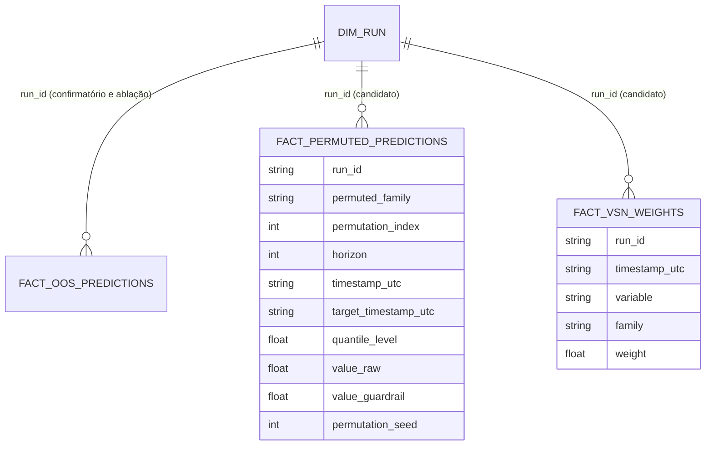

# Concept — Stage 7.3 — Explicabilidade para H3

> **Escopo deste documento:** o que será feito nesta Stage, por quê, e
> decisões técnicas relevantes para entender o "porquê". O plano executável
> fica no [`technical.md`](./technical.md) correspondente.
>
> **Stage é a unidade de ciclo concept→technical→execução.** Sobre
> hierarquia (Step → Stage → Task) e critérios de atomicidade, ver
> [`PIPELINE.md`](../../PIPELINE.md) §4.
>
> **Status (apenas dois estados).** `draft` desde a criação; `done` após
> o gate humano. Regressão `done → draft` é **permitida** quando a
> Fase 3B (Technical) revela gap material aqui — neste caso, commit
> `chore(concept): revert to draft — revision-from-technical: <motivo>`.
> O Passo 8 do runbook (início da Fase 4) exige `concept.status == done`
> **e** `technical.status == done` simultaneamente.

A teoria está fechada no [doc de domínio inference](../../domain/inference/conformal-benchmark-and-feature-attribution.md)
§5, §7 e §10.1 (P-H3-VSN, P-ABLACAO, C1–C8) e no
[ADR 0.0.0007](../../adr/0_0_0007-h3-family-contribution-across-horizons.md),
com a errata do ADR 0.0.0016 (#151). Este concept não re-decide a permutação
de grupo, a medida, o LOCO com re-treino, a regra de leitura nem a partição.
Ele decide quem calcula cada coisa, onde as predições vivem, como o treino
LOCO se identifica e roda em GPU, os valores que a r3 congela e o corte entre
o Windows e o Linux.

## 1. Escopo

### Dentro do escopo

**Fase Windows** (Tasks do technical; tudo com dado sintético):

1. **Treino por subconjunto de famílias** (modeling; ADR 7.3.0003):
   `TrainTftCommand.excluded_family` e `model_version` com defaults que mantêm
   o confirmatório idêntico; painel aparado pelo conjunto completo de colunas
   (ADR 5.5.0004) antes de tirar as da família; `feature_set_hash` do
   subconjunto no `RunId`.
2. **Device por instância do treinador** (modeling + composition root; ADR
   7.3.0004): `PfTftTrainer(accelerator)`, mapa `{"cpu": "cpu", "rocm":
   "gpu"}`, um treinador por device; CPU byte a byte igual ao de hoje; o probe
   ganha GPU e HIP só quando o device não é `cpu`.
3. **Cohort de ablação** (modeling; ADR 7.3.0003): `AblationCohortSpec` que
   referencia o confirmatório pelo arquivo, `cohort_id` e `cohort_hash`; as 5
   configurações; `config/cohorts/aapl_ablation.toml` em rascunho (seeds
   vazias, `torch_build` ausente); `RunAblationCohort` retomável, reusando o
   lock, a foto de ambiente, o ledger e a classificação de unidade do
   `RunConfirmatoryCohort` (extraídos, não copiados); `MeasureAblationCost`
   (piloto, nada no silver); subcomandos `ablation-pilot`, `ablation-run`,
   `ablation-verify`, `ablation-freeze`.
4. **Predição sob permutação e VSN** (modeling; ADR 7.3.0002): método
   `predict_attribution_from_checkpoint` no `TftCheckpointPredictor`/`PfTftTrainer`
   (bytes lidos uma vez; mesmo dataset de predição; mesmo dataloader com um
   `collate_fn` que troca o bloco do encoder das colunas da família pelo da
   decisão doadora; passagem de identidade pelo caminho exato do `_emit`; VSN
   da passagem de identidade) e o use case fornecedor
   `PredictTftAttributionFromCheckpoints`, com a guarda C6 (coluna de família
   `known` ⇒ recusa).
5. **Silver** (analytics_store; ADR 7.3.0002): tabelas
   `fact_permuted_predictions` e `fact_vsn_weights`, com schema `pandera` no
   `SILVER_REGISTRY` e escritores `PersistPermutedPredictions` e
   `PersistVsnWeights`.
6. **Atribuição no inference** (ADR 7.3.0002, 7.3.0005): VO
   `FamilyPermutationPlan` (stdlib) no domain; use case `RunPermutationInference`
   com ports do consumidor (`CheckpointAttributionPredictor`,
   `PermutedPredictionPersister`, `VsnWeightPersister`, `AttributionManifest`),
   conferência da identidade contra o silver pela política de reprodução da
   7.2, manifesto write-ahead, retomada por run; subcomando `attribute`.
7. **Estatística de H3 no evaluation** (ADR 7.3.0001): VO `H3Parameters`
   (bloco `[h3]` do `Preregistration`, proibido no r0); `AttributionAssembly`,
   `FamilyLossDifferentials`, `FamilyContribution`, `ContributionAgreement`,
   `VsnSummary`; intervalo básico conferido contra o `arch` como oráculo.
8. **Integração no gold** (ADR 7.3.0001): `RefreshParameters.h3_parameters`
   (por `refresh_command_from`, conferido pelo `check_manifest`); leitura da
   partição do cohort de ablação e das duas tabelas silver novas; um plano de
   bootstrap para tudo; tabelas `gold_h3_importance`, `gold_h3_shares`,
   `gold_h3_reading`, `gold_h3_vsn`; wiring no composition root.
9. **Rascunho da r3** (ADR 7.3.0005):
   `docs/stages/7.3-explainability/aapl_confirmatory-r3.draft.toml` com três
   valores sentinela; teste que o preenche com valores sintéticos e o valida.
10. **Etapa W (opcional no Windows):** `attribute` sobre os 60 checkpoints
    reais do confirmatório no ambiente CPU da 7.1 — só predições e pesos, sem
    pontuar.
11. **Docs:** roadmap (7.3, 7.4, 8.1 e changelog, neste commit do concept),
    LAYOUT §7 (contratos novos, arestas novas) e `[handoff]` na §7 do
    technical + comentário na #186.

**Fase Linux** (Etapas L1–L8 do ADR 7.3.0006): ambiente ROCm, piloto,
decisão das seeds (P do humano), freeze e âncora do cohort de ablação, ~5 × 6 × S
treinos, `verify`, Etapa W se ainda não feita, r3 preenchida e ancorada,
auditoria da Stage e merge.

### Fora do escopo (explicitamente)

- **Qualquer pinball, b̂, intervalo ou leitura de H3 sobre dado real** —
  inclusive o refresh com a r3 (cegamento, doc §7). A primeira pontuação real
  é a da 8.1.
- Perfil descritivo de permutação do subgrupo de volatilidade (doc §5.2 (iii);
  ADR 7.3.0005, H3-VOL). A ressalva de leitura (ii) fica no texto do relatório.
- Leitura das tabelas de H3 pelo scorecard (evidência, veredito ou
  `ScorecardProfile`): H3 é conclusão descritiva separada de H1 → H2 (C7).
- Comparar o modelo completo da ablação com o candidato confirmatório (doc §5.5
  "se feito, é por tolerância"): não é feito.
- SHAP, gradientes integrados, atenção temporal por horizonte (P-H3-VSN; doc §5.3).
- Índice ROCm no `pyproject.toml`/`uv.lock` (ADR 7.3.0004).
- API (7.4), plots (8.3), a #58 e a #163 (bloqueadas pela 8.1).

### Vínculo com o roadmap

Step 7, Stage 7.3 do [`roadmap.md`](../../roadmap.md): "importância por
permutação por família (janela inteira, em conjunto) e ablação LOCO com
re-treino ... num cohort de ablação congelado e hasheado próprio, ambas com IC
por bootstrap em bloco pareado; H3 sustentada se as duas concordam". Overview
§4 (H3), §3 (descritivo, sem causalidade). O roadmap da 7.3, 7.4 e 8.1 é
emendado por este concept (D1, D10).

## 2. Objetivo da Stage

Ao fechar, o silver guarda as predições do candidato com cada família
permutada (e a passagem de identidade) e os pesos da VSN, e guarda as
predições de teste de um cohort de ablação LOCO treinado em GPU, congelado e
hasheado; o `RefreshGold` derivado de uma r3 ancorada antes de qualquer
métrica sobre esses dados publica, na mesma geração, a participação de cada
família por horizonte nos dois métodos, os intervalos de Δ_f e a leitura
mecânica e descritiva de H3, tudo provado só sobre silver sintético.

## 3. Contexto e premissas

### Contexto

- O candidato tem 60 checkpoints (10 seeds × 6 folds) que a 7.1 reproduziu
  em `strict` com max |Δ| = 0; ~20 s por run para re-predizer o teste (technical
  7.1 §7, E5). O cohort é `aapl_confirmatory-r0-665f45d9169a`, `device = "cpu"`.
- A registry tem 55 features, todas `unknown`: price 17, technical 17,
  sentiment 11, fundamental 10 (medido em 2026-10-18; `feature_set_hash`
  7df0e1b4…; hashes dos subconjuntos sem price 7631c0ae…, sem technical
  b75eca48…, sem sentiment 5f737061…, sem fundamental c58b322f…).
- O TFT recebe também o calendário (known), o alvo passado e o índice
  relativo — fora das famílias (C6).
- `fact_oos_predictions` tem PK `(run_id, split, horizon, timestamp_utc,
  target_timestamp_utc, quantile_level)`; o `SeriesAssembly` agrupa por
  `(model_version, seed)` (`series_assembly.py` L282).
- `_TRAINERS_DEVICE = "cpu"` é global (`composition_root.py` L344) e o adapter
  fixa `accelerator="cpu"` (`pf_tft_trainer.py` L512–518, L707–711).
- A cadeia ancorada é r0 → r1; a 7.2 acrescenta r2 com `[conformal]` e torna
  públicas as regras de alinhamento do `series_assembly.py` (ADR 7.2.0003).

### Premissas

- **P1 — 7.2 mergeada antes da Fase 4** (r2 ancorada; funções públicas de
  regra; `reproduction_policy` no domain do inference). É pré-condição da
  execução, não da aprovação deste concept (ADR 7.3.0006 item 1).
- **P2 — nenhuma feature das 4 famílias é `known`** (C6/P-H3-VSN). Verificada
  em código em dois pontos: teste sobre a registry e guarda no fornecedor da
  atribuição contra os `known` do checkpoint (I8). A #58 (calendário na
  registry com `tft_typing = known`) só entra depois da 8.1; se entrar com o
  calendário fora das 4 famílias, a premissa continua valendo e a partição da
  r3 (listas congeladas) não muda; se pusesse um calendário numa das 4, a
  guarda recusaria e P-H3-VSN teria de ser reaberta.
- **P3 — ROCm instala sobre o ambiente travado** (ADR 7.3.0004 item 4) e o
  treino `deterministic=True` roda na RX 7700 XT. O piloto confirma; senão,
  `[decision]` no Linux antes do freeze.
- **P4 — a geometria do cohort de ablação é a do confirmatório** (mesmo grid,
  mesmo corte; ADR 5.5.0004), logo os mesmos pontos de decisão de teste; o
  refresh confere (I11).

### Dependências

- `7.1-inference-engine` (`done`): `CheckpointResolver`, `CheckpointGridPredictor`,
  `PredictTftFromCheckpoints`, `_emit`, contrato de reprodução, manifesto.
- `6.1-scoring-and-calibration-metrics` (`done`): `PinballScore`, `CoverageSeries`.
- Também consumidas (`done`): 5.4/5.5 (`TrainTft`, `PfTftTrainer`, `CohortSpec`,
  executor de cohort), 6.2 (`McsBackend`, `BootstrapIndices`, `block_length_rule`),
  6.4–6.6 (`RefreshGold`, `gold_schema`, `refresh_command_from`, `check_manifest`),
  6.5 (`Preregistration`, âncora), 3.4 (`FeatureRegistry`).
- `7.2-conformal-cqr` (**em voo**, dependência formal — `depends_on`): r2, regras
  públicas do `series_assembly.py`, `reproduction_policy` no domain do inference — P1.

## 4. Contratos

Formas ilustrativas; nomes finais de chave/coluna no technical.

### Introduzidos

**Modeling — application** (`features/modeling/application/`):

```python
# use_cases/train_tft.py (modificado; defaults = comportamento de hoje)
@dataclass(frozen=True)
class TrainTftCommand:
    ...                                   # campos atuais
    excluded_family: str | None = None    # None = registry inteira
    model_version: str = MODEL_VERSION    # "tft_quantile"

def load_tft_panel(*, store, asset_id, excluded_family: str | None = None) -> TftPanel
    # corte do grid pelo conjunto COMPLETO de colunas; só depois saem as da família
def tft_feature_set_hash(excluded_family: str | None) -> str   # feature_set_hash() quando None

# dtos/ablation_cohort_spec.py  (ADR 7.3.0003)
ABLATION_CONFIGURATIONS: Final = ("full", "minus_price", "minus_technical",
                                  "minus_sentiment", "minus_fundamental")
@dataclass(frozen=True)
class AblationConfiguration:
    name: str                             # um de ABLATION_CONFIGURATIONS
    excluded_family: str | None           # None em "full"
    model_version: str                    # "tft_quantile_loco_<name>"
    feature_set_hash: str                 # do subconjunto da registry

@dataclass(frozen=True)
class AblationCohortSpec:
    name: str
    revision: int
    base_cohort_file: str
    base_cohort_id: str
    base_cohort_hash: str
    feature_set_name: str                 # "fs_all_ablation" — partição própria
    configurations: tuple[AblationConfiguration, ...]   # as 5, nesta ordem
    family_partition: Mapping[str, tuple[str, ...]]     # família → features
    seeds: tuple[int, ...]                # [P] vazio no rascunho
    device: str                           # chave de _SUPPORTED_DEVICES
    torch_build: str | None               # versão instalada do torch; None no rascunho
    def is_frozen(self) -> bool: ...      # seeds não vazias e torch_build declarado
    def hash_payload(self) -> dict[str, object]: ...
    def cohort_id(self, cohort_hash: CohortHash) -> str: ...   # "<nome>-r<rev>-<12 hex>"

# use_cases/run_ablation_cohort.py
class RunAblationCohort:
    def __call__(self, command: RunAblationCohortCommand) -> RunAblationCohortResult: ...
    # unidades "tft:<configuração>:seed=<s>"; resultado com cohort_id, hash e desfecho por unidade

# use_cases/measure_ablation_cost.py (piloto)
@dataclass(frozen=True)
class AblationCostReport:
    configuration: str; seed: int; fold_index: int
    wall_seconds: float; epochs_run: int; best_epoch: int
    seconds_per_epoch: float; max_epochs: int      # max_epochs do tft_params congelado
    device: str; torch_build: str
    ceiling_seconds: Mapping[int, float]           # S → 5 · n_folds · S · max_epochs · seconds_per_epoch (TETO)
    estimate_seconds: Mapping[int, float]          # S → 5 · n_folds · S · wall_seconds (ESTIMATIVA, não teto)
class MeasureAblationCost:
    def __call__(self, command: MeasureAblationCostCommand) -> AblationCostReport: ...

# ports/out/tft_checkpoint_predictor.py (método novo; o da 7.1 fica igual)
@dataclass(frozen=True)
class TftAttributionPrediction:
    identity: Mapping[int, GridByHorizon]                         # = caminho do _emit
    permuted: Mapping[tuple[str, int], Mapping[int, GridByHorizon]]   # (família, k) → decisão → grade
    encoder_weights: Mapping[int, Mapping[str, float]]            # decisão → variável → peso
    normalizer_center: float
    normalizer_scale: float
    settings: Mapping[str, str]

class TftCheckpointPredictor(Protocol):
    def predict_attribution_from_checkpoint(self, *, checkpoint_path: str,
        expected_sha256: str, feature_names: Sequence[str],
        known_feature_names: Sequence[str], rows: Sequence[Sequence[float]],
        target: Sequence[float], decision_indices: Sequence[int], max_horizon: int,
        horizons: Sequence[int], quantile_levels: Sequence[float], batch_size: int,
        num_threads: int, permuted_columns: Mapping[str, Sequence[str]],
        donors: Sequence[Sequence[int]]) -> TftAttributionPrediction: ...
    # donors[k][i] = posição (em decision_indices ordenado) da decisão que doa
    # o bloco do encoder à decisão i na permutação k

# use_cases/predict_tft_attribution_from_checkpoints.py  (fornecedor; ADR 7.3.0002)
@dataclass(frozen=True)
class PredictTftAttributionCommand:
    spec: CohortSpec
    seed: int
    allowed: Mapping[str, str]                                  # run_id → sha256
    num_threads: int
    donors_by_fold: Mapping[int, tuple[tuple[int, ...], ...]]   # fold → K_p permutações

@dataclass(frozen=True)
class AttributionRunPrediction:
    run_id: str; fold_index: int; checkpoint_sha256: str
    normalizer_center: float; normalizer_scale: float
    test_decisions: tuple[int, ...]
    family_columns: Mapping[str, tuple[str, ...]]
    identity: Mapping[int, Mapping[int, tuple[float, ...]]]
    permuted: Mapping[tuple[str, int], Mapping[int, Mapping[int, tuple[float, ...]]]]
    encoder_weights: Mapping[int, Mapping[str, float]]

@dataclass(frozen=True)
class PredictTftAttributionResult:
    cohort_id: str; seed: int; dataset_timestamps: tuple[str, ...]
    settings: Mapping[str, str]; runs: tuple[AttributionRunPrediction, ...]

class FamilyFeatureKnownError(ApplicationError): ...   # C6: coluna de família é known no checkpoint
```

**Modeling — adapters/out:** `PfTftTrainer(accelerator: str = "cpu")` e
`predict_attribution_from_checkpoint`; `GitRuntimeEnvironmentProbe` com chaves
de GPU/HIP só para device ≠ `cpu`. **Composition root:**
`_SUPPORTED_DEVICES`; `ablation_cohort_for(path)` lê o `device` do próprio spec de
ablação (nada de device por argumento); `permutation_inference_for(path)` usa
sempre o treinador `cpu` (os checkpoints confirmatórios são CPU e a
identidade é conferida contra o silver da 7.1).

**Inference** (`features/inference/`):

```python
# domain/value_objects/permutation_plan.py (stdlib)
PERMUTATION_ALGORITHM: Final = "fisher_yates_random_random_v1"
@dataclass(frozen=True)
class FamilyPermutationPlan:
    permutation_seed: int
    k_p: int
    fold_index: int
    n_decisions: int
    permutations: tuple[tuple[int, ...], ...]   # K_p permutações de range(n_decisions)
    @classmethod
    def generate(cls, *, permutation_seed: int, k_p: int, fold_index: int,
                 n_decisions: int) -> FamilyPermutationPlan: ...

# application/ports/out/checkpoint_attribution_predictor.py  (port do consumidor)
class CheckpointAttributionPredictor(Protocol):
    def __call__(self, command: PredictTftAttributionCommand) -> PredictTftAttributionResult: ...
# application/ports/out/{permuted_prediction_persister.py, vsn_weight_persister.py,
#                        attribution_manifest.py}

# application/use_cases/run_permutation_inference.py
@dataclass(frozen=True)
class RunPermutationInferenceCommand:
    spec: CohortSpec
    family_partition: Mapping[str, tuple[str, ...]]   # [partition] do aapl_ablation.toml (= [h3.partition])
    permutation_seed: int        # 130 (r3)
    k_p: int                     # 10 (r3)
    break_stale_lock: bool = False
    cross_environment: str | None = None   # mesma regra do `infer` (ADR 7.1.0003 item 3)

@dataclass(frozen=True)
class AttributionRunOutcome:
    run_id: str; status: str     # "written" | "verified" (completo, re-conferido)
    mode: str                    # "strict" | "tolerance" (identidade × silver)
    max_abs_diff: float; permuted_rows: int; vsn_rows: int

class RunPermutationInference:
    def __call__(self, command: RunPermutationInferenceCommand) -> RunPermutationInferenceResult: ...
```

**Analytics_store:** `fact_permuted_predictions` e `fact_vsn_weights`
(colunas, PK e `partition_by` com `run_id` no ADR 7.3.0002 item 4) e os use
cases `PersistPermutedPredictions` e `PersistVsnWeights`.

**Shared:** VO de identidade `FamilyPartitionHash`
(`shared/domain/value_objects/family_partition_hash.py`, `compute(hasher=...,
feature_set_hash=..., partition=...)`, padrão do `CohortHash`), usado pelo
inference ao gravar e pelo evaluation ao conferir.

**Docstrings emendadas:** `analytics_store/application/ports/out/analytics_repository.py`
(L18–21) e `adapters/out/parquet/parquet_analytics_repository.py` (L12) passam
de "1..3 níveis" de partição para "1..4" (`run_id` nas duas tabelas novas).

**Outros módulos:** `modeling/application/use_cases/cohort_unit_runner.py`
(lock, ambiente, ledger e classificação compartilhados — o executor
confirmatório e o de ablação importam dele, nunca um do outro);
`modeling/adapters/in/cli/ablation_cohort_file.py` (loader do TOML de
ablação); `inference/adapters/out/filesystem/json_attribution_manifest.py`
(real do `AttributionManifest`); `inference/adapters/in/cli/inference_commands.py`
(subcomando `attribute`).

**Evaluation — domain** (`features/evaluation/domain/`, stdlib):

```python
# value_objects/h3_parameters.py  (ADR 7.3.0005)
H3_RULE_CATALOG: Final[Mapping[str, str]]     # chave → único identificador implementado
@dataclass(frozen=True)
class H3Parameters:
    families: tuple[str, ...]                          # as 4 do ADR 0.0.0016
    partition: Mapping[str, tuple[str, ...]]
    feature_set_hash: str
    partition_hash: str                                # literal da r3, conferido por teste
    k_p: int
    permutation_seed: int
    reps: int
    bootstrap_seed: int
    family_alpha: float                                # 0.05; nível = 1 − α/|families|
    ablation_cohort_id: str
    ablation_cohort_hash: str
    ablation_seeds: tuple[int, ...]
    ablation_reference_model: str                      # "tft_quantile_loco_full"
    ablation_models: Mapping[str, str]                 # família → model_version
    # + identificadores do catálogo (esquema, algoritmo, medida, pareamento,
    #   agregação de seeds, bootstrap, regra de bloco, intervalo, multiplicidade,
    #   total não positivo, regra de leitura, resumo da VSN)
    @property
    def interval_level(self) -> float: ...
    @classmethod
    def from_mapping(cls, mapping: Mapping[str, object]) -> H3Parameters: ...
    def as_payload(self) -> dict[str, object]: ...

# value_objects/{permuted_forecast_record.py, vsn_weight_record.py, family_loss_differentials.py}
@dataclass(frozen=True)
class FamilyLossDifferentials:
    method: str                                        # "permutation" | "loco"
    families: tuple[str, ...]
    horizons: tuple[int, ...]                          # (1, 7)
    decision_timestamps: tuple[str, ...]               # interseção dos horizontes, crescente
    differentials: Mapping[tuple[str, int], tuple[float, ...]]   # (família, h) → d_t
    seed_importances: Mapping[tuple[str, int, int], float]       # (família, h, seed) → I (perfil)
    permutation_importances: Mapping[tuple[str, int, int], float]  # (família, h, k) → I (perfil; vazio no LOCO)

# services/attribution_assembly.py
@dataclass(frozen=True)
class AttributionAssemblyResult:
    permutation: FamilyLossDifferentials | None
    permutation_reason: str | None
    ablation: FamilyLossDifferentials | None
    ablation_reason: str | None
class AttributionAssembly:
    @staticmethod
    def assemble(*, candidate_runs: Sequence[CohortRun],
                 permuted: Sequence[PermutedRunLosses],   # uma redução por run, não registros
                 ablation_runs: Sequence[CohortRun],
                 ablation_losses: Sequence[AblationRunLosses],   # uma redução por run
                 realized: RealizedReturns, parameters: H3Parameters,
                 candidate: str, candidate_seeds: tuple[int, ...],
                 horizons: tuple[int, ...], levels: tuple[float, ...]) -> AttributionAssemblyResult: ...

# value_objects/permuted_run_losses.py + função de redução (domain)
@dataclass(frozen=True)
class PermutedRunLosses:                    # o que sobra de UM run depois da leitura
    run_id: str; seed: int; fold_index: int
    permutation_seed: int; permutation_algorithm: str; partition_hash: str
    decision_timestamps: tuple[str, ...]
    identity: Mapping[int, tuple[float, ...]]                     # h → L_t
    permuted: Mapping[tuple[str, int, int], tuple[float, ...]]    # (família, k, h) → L_t
def reduce_permuted_run(records: Sequence[PermutedForecastRecord], *,
                        realized: RealizedReturns, levels: tuple[float, ...]) -> PermutedRunLosses: ...
@dataclass(frozen=True)
class AblationRunLosses:                    # mesmo padrão, um run da ablação
    run_id: str; model_version: str; seed: int; fold_index: int
    decision_timestamps: tuple[str, ...]
    losses: Mapping[int, tuple[float, ...]]                       # h → L_t
def reduce_ablation_run(records: Sequence[ForecastRecord], *, run: CohortRun,
                        realized: RealizedReturns, levels: tuple[float, ...]) -> AblationRunLosses: ...

@dataclass(frozen=True)
class VsnRunWeights:                        # um run do candidato
    run_id: str; seed: int; fold_index: int
    weights: Mapping[str, Mapping[str, float]]                    # decisão → variável → peso
def reduce_vsn_run(records: Sequence[VsnWeightRecord]) -> VsnRunWeights: ...
# Tabelas novas: o RefreshGold lê UM run por chamada (filtro de partição `run_id`),
# reduz e descarta os registros antes de ler o próximo. Ablação: `fact_oos_predictions`
# não tem `run_id` na partição, então a partição `fs_all_ablation` é lida UMA vez por
# `year` (coluna de partição, ~6 blocos); dentro de cada bloco as linhas são reduzidas
# por run e descartadas, e as reduções parciais de um run que cruza o ano são unidas.

# services/family_contribution.py
@dataclass(frozen=True)
class FamilyShare:
    family: str
    share_h1: float | None; share_h7: float | None; delta: float | None
    lower: float | None; upper: float | None
    side: int | None                                   # −1 | 0 | +1 = sinal de Δ̂_f
    excludes_zero: bool | None                         # intervalo exclui 0 estrito, do lado de Δ̂
    status: str; reason: str | None                    # "ok" | "undefined" por família

@dataclass(frozen=True)
class FamilyContributionReport:
    method: str
    importance: Mapping[tuple[str, int], float]        # (família, h) → I_f(h)
    shares: tuple[FamilyShare, ...]
    level: float
    nonpositive_replicas: Mapping[int, int]            # h → nº de réplicas com Σ* ≤ 0
    # réplicas com Σ* ≤ 0 ficam nas B: +∞ em q_{1−a/2} e −∞ em q_{a/2} (os dois limites alargam) — I14
    status: str                                        # "ok" | "undefined"
    reason: str | None
    heterogeneous: bool | None

class FamilyContribution:
    @staticmethod
    def evaluate(differentials: FamilyLossDifferentials, *,
                 bootstrap: BootstrapIndices, level: float) -> FamilyContributionReport: ...

def linear_quantile(values: Sequence[float], probability: float) -> float: ...   # tipo 7

# services/contribution_agreement.py
H3_LABEL: Final = "descritiva (sem claim causal)"
@dataclass(frozen=True)
class H3Reading:
    heterogeneous_permutation: bool | None
    heterogeneous_ablation: bool | None
    sustained: bool                                    # False quando qualquer método é undefined
    agreeing_families: tuple[str, ...]
    status: str; reason: str | None
    label: str = H3_LABEL
class ContributionAgreement:
    @staticmethod
    def read(permutation: FamilyContributionReport,
             ablation: FamilyContributionReport) -> H3Reading: ...

# services/vsn_summary.py
VSN_LABEL: Final = "horizonte-invariante; descreve quanto o modelo usa cada família"
class VsnSummary:
    @staticmethod
    def summarize(reductions: Sequence[VsnRunWeights], *, parameters: H3Parameters,
                  seeds: tuple[int, ...]) -> VsnSummaryReport: ...   # p10/p50/p90 por variável e família
```

`Preregistration` ganha `h3: H3Parameters | None` (chave opcional `h3`,
proibida no r0; cruzamentos: famílias = as 4 do ADR 0.0.0016, partição
disjunta, modelos da ablação distintos do candidato e dos comparadores).

**Evaluation — application e gold** (ADR 7.3.0001):

```python
# application/dtos/refresh_gold.py
class RefreshParameters:   h3_parameters: H3Parameters | None   # chave obrigatória no manifesto
class GoldInputs:          h3_reports: H3Reports                 # vazio sem [h3] ou se BLOCKED
@dataclass(frozen=True)
class H3Reports:
    permutation: FamilyContributionReport | None
    ablation: FamilyContributionReport | None
    reading: H3Reading | None
    vsn: VsnSummaryReport | None
    block_length: int | None; max_block_estimate: float | None; n_points: int | None
# application/dtos/gold_schema.py
GOLD_H3_IMPORTANCE, GOLD_H3_SHARES, GOLD_H3_READING, GOLD_H3_VSN: Final[GoldTableSchema]
# as quatro em GOLD_SCHEMAS e em CONFIRMATORY_TABLES
```

Builders em `adapters/out/duckdb/gold_builders/{h3_importance.py,
h3_shares.py, h3_reading.py, h3_vsn.py}` (mapeamento puro, fora de
`runs_when_blocked`).

**Config:**

```toml
# config/cohorts/aapl_ablation.toml (rascunho; forma ilustrativa)
name = "aapl_ablation"
revision = 0
feature_set_name = "fs_all_ablation"
device = "rocm"
seeds = []                       # [P] depois do piloto
# torch_build ausente até o freeze
[base]
cohort_file = "config/cohorts/aapl_confirmatory.toml"
cohort_id = "aapl_confirmatory-r0-665f45d9169a"
cohort_hash = "665f45d9169aba576d194e73d45c0508f51f231f573c4de283c96fc5847365b1"
[partition]
price = ["open", "high", "..."]  # as 17; technical 17; sentiment 11; fundamental 10
```

```toml
# bloco [h3] da r3 (forma ilustrativa; valores fixados no ADR 7.3.0005)
[h3]
families = ["price", "technical", "sentiment", "fundamental"]
feature_set_hash = "7df0e1b4d6e93e3edb5695414a47d2d77882a2ffc674d00037f2a9f87a6409e0"
permutation_scheme = "whole_encoder_window_joint_between_fold_test_decisions_v1"
permutation_algorithm = "fisher_yates_random_random_v1"
k_p = 10
permutation_seed = 130
measure = "grid_mean_pinball_difference_guardrail_v1"
pairing = "decision_point_horizon_intersection_v1"
seed_aggregation = "pointwise_seed_mean_then_permutation_mean_v1"
bootstrap_scheme = "stationary"
block_rule = "max_7_ceil_max_bsb_joint_16_series_v1"
reps = 1000
bootstrap_seed = 129
interval = "basic_linear_percentile_v1"
multiplicity = "bonferroni_over_families_v1"
family_alpha = 0.05
nonpositive_total = "undefined_if_point_total_nonpositive_replicas_as_infinite_v1"
reading_rule = "interval_side_agreement_same_family_v1"
vsn_summary = "per_decision_seed_mean_p10_p50_p90_family_sum_v1"
[h3.partition]
partition_hash = "<FamilyPartitionHash calculado ao redigir>"
price = ["open", "high", "..."]
[h3.ablation]
cohort_id = "__FILL_AFTER_FREEZE__"
cohort_hash = "__FILL_AFTER_FREEZE__"
seeds = "__FILL_AFTER_FREEZE__"
reference_model = "tft_quantile_loco_full"
models = { price = "tft_quantile_loco_minus_price", technical = "tft_quantile_loco_minus_technical", sentiment = "tft_quantile_loco_minus_sentiment", fundamental = "tft_quantile_loco_minus_fundamental" }
```

### Consumidos

- **`TrainTft`, `load_tft_panel`, `tft_run_identity`, `PfTftTrainer`,
  `_prediction_dataset`, `_emit`, `TftTrainingParams`**: Stages 5.4/7.1.
- **`CohortSpec`, `check_cohort_declarations`, `recorded_run_problems`,
  `tft_train_command`, ledger, `CohortRunIndex`, probe**: Stage 5.5.
- **`CheckpointResolver`, `ResolveTftCheckpoints`, `CheckpointLocator`,
  manifesto de inferência (padrão)**: Stage 7.1.
- **`reproduction_policy`, regras públicas do `series_assembly.py`, r2**: Stage
  7.2 (P1).
- **`PinballScore`, `CoverageSeries`**: Stage 6.1. **`McsBackend`,
  `BootstrapIndices`, `block_length_rule`, `validate_block_length_request`**:
  Stage 6.2. **`RefreshGold`, `SilverTableReader`, `TrainingGridReader`,
  `GoldStore`, `gold_schema`, `ForecastRecord`, `CohortRun`, `RealizedReturns`**:
  Stage 6.4. **`Preregistration`, `refresh_command_from`, `check_manifest`,
  âncora, espelho**: Stages 6.5/6.6.
- **`FEATURE_SPECS`, `list_feature_specs`, `feature_set_hash(specs)`**: Stage 3.4.
- **`PersistPredictions`, `QuantileForecast.from_raw`, `SILVER_REGISTRY`**:
  Stages 4.1–4.3.

## 5. Invariantes e regras

- **I1 — confirmatório intacto.** Com `excluded_family = None` e
  `model_version` default, `config_signature`, `run_id` e todo valor gravado do
  `TrainTft` são os de hoje (teste fixa o `run_id` de um fold); o
  `CohortSpec`, o hash do r0 e o `PfTftTrainer()` CPU não mudam; todos os
  testes de 5.4, 5.5 e 7.1 passam sem mudar asserção.
- **I2 — geometria fixa.** O painel de qualquer configuração é aparado pelo
  conjunto completo de colunas de modelagem antes de tirar as da família;
  folds, decisões e `split_fingerprint` são idênticos entre as 5 configurações
  e o confirmatório (teste).
- **I3 — identidade por configuração.** `model_version =
  tft_quantile_loco_<configuração>`; `feature_set_hash` do `RunId` = o do
  subconjunto; `feature_set_name` = o **próprio do cohort de ablação**
  (`fs_all_ablation`, declarado no spec e no hash; o mesmo nas 5
  configurações), de modo que as linhas da ablação ficam noutra partição de
  `fact_oos_predictions` e o `_read_records` do refresh confirmatório nunca as
  carrega; `parent_sweep_id` = o `cohort_id` da ablação. Nenhum par (configuração, seed) colide no índice de
  runs nem no `SeriesAssembly`.
- **I4 — mesmo procedimento.** As configurações herdam do spec base
  `tft_params`, geometria, horizontes, níveis, `dataset_fingerprint` e
  `pipeline_version`; o arquivo da ablação não os declara, e o hash do base é
  conferido na carga.
- **I5 — device e build declarados e observados.** `device` e `torch_build`
  entram no hash da ablação. A chave `device` do probe só ecoa o declarado,
  então para device ≠ `cpu` o probe grava chaves **observadas** (GPU
  disponível, nome da GPU, versão do HIP) e o `RunAblationCohort` recusa,
  antes de treinar, GPU indisponível, HIP ausente ou versão do torch ≠
  `torch_build`; as declarações do base passam pelo `check_cohort_declarations`
  com o device do base. O probe de `cpu` é idêntico ao de hoje.
- **I6 — permutação.** Por fold, π_k é uma permutação uniforme das posições das
  decisões de teste, função só de (`permutation_seed`, fold, k); a mesma para
  todas as seeds e famílias. Algoritmo `fisher_yates_random_random_v1`: um
  `random.Random(permutation_seed * 1000 + fold_index)` por fold; as K_p
  permutações saem em sequência (j = 0..K_p − 1) e são gravadas com
  `permutation_index = j + 1`; cada uma é Fisher–Yates de range(n) com
  `i` de n − 1 a 1 e `r = floor(random() · (i + 1))`, troca de i e r. Os blocos
  doadores (encoder das colunas da família, por decisão) são extraídos
  **antes** das passagens, do próprio dataset de predição, da amostra de
  decoder mais longo de cada decisão; o `collate_fn` só substitui a partir
  dessa tabela, então o doador pode estar em qualquer lote. A troca atinge só `encoder_cont[:, :L, colunas
  de f]`; alvo passado, índice relativo, calendário e as outras famílias ficam
  intactos; o decoder não lê as colunas de família (P2).
- **I7 — identidade.** A passagem `permuted_family = "none"`,
  `permutation_index = 0` sai pelo mesmo dataloader e pelo `_emit`: no mesmo
  processo, é igual a `predict_from_checkpoint` valor a valor (teste); contra
  as linhas de teste do silver, passa pela política de reprodução da 7.2
  (`strict` no ambiente da 7.1, `tolerance` fora) antes de qualquer gravação do
  run. Toda diferença d_{f,t} usa a identidade da mesma tabela.
- **I8 — guarda C6.** O fornecedor exige que **toda** coluna de família da
  partição seja real `unknown` do encoder no checkpoint (está em
  `time_varying_unknown_reals` do `dataset_parameters` e não em
  `time_varying_known_reals`); senão `FamilyFeatureKnownError`. Um teste da
  registry assere que toda spec das 4 famílias é `unknown`.
- **I9 — cegamento.** Nenhum teste, script ou Etapa desta Stage calcula
  pinball, b̂, intervalo ou leitura sobre linhas do cohort real ou do cohort de
  ablação; a Etapa W, o piloto e o treino leem e gravam só predições, pesos,
  tempos e épocas; nenhum `gold/` é criado sobre dado real.
- **I10 — medida.** d_{f,t}(h) = média nas seeds da média nas K_p permutações
  de (L^{perm f,k}_{s,t}(h) − L^{id}_{s,t}(h)); LOCO: média nas seeds de
  L^{−f}_{s,t}(h) − média nas seeds de L^{full}_{s,t}(h); L_t =
  `PinballScore.per_point_losses` sobre o vetor `value_guardrail`; t percorre
  os pontos de decisão presentes em h+1 e h+7 (interseção).
- **I11 — alinhamento.** As regras de alinhamento são as funções públicas do
  `series_assembly.py` (uma definição por regra); conjuntos de pontos de decisão
  iguais entre os dois métodos; seeds, K_p, famílias e configurações completas
  por run. Qualquer violação torna o método `undefined` com o motivo; nunca vira
  `AlignmentFinding`.
- **I12 — bootstrap único.** b̂ de Politis–White das 16 séries; bloco =
  `block_length_rule(horizon=7, max_estimate=max b̂)`; uma chamada
  `bootstrap_indices(n_obs=T, block, reps=1000, seed=129, stationary)` serve aos
  dois métodos, às 4 famílias e aos 2 horizontes. Série inválida ou
  `ArithmeticError` ⇒ leitura `undefined`.
- **I13 — intervalo.** Básico, [2Δ̂ − q_{1−a/2}, 2Δ̂ − q_{a/2}], quantis tipo 7
  sobre as B réplicas (as de Σ* ≤ 0 como ±∞, I14), a = 0,05/4 (nível 0,9875)
  em cada método; igual ao `arch.conf_int(method="basic")` sobre os mesmos
  índices quando nenhuma réplica tem Σ* ≤ 0 (teste de oráculo,
  `abs_tol = 1e-12`).
- **I14 — total não positivo.** Importâncias com o sinal (sem corte). O método
  só é `undefined` se Σ_g I_g(h) ≤ 0 **no ponto**, em h = 1 ou 7. Uma réplica
  com Σ*_g I*_g(h) ≤ 0 em h = 1 **ou** h = 7 (Δ* indefinido) fica nas B
  réplicas e entra nos quantis no espaço das réplicas: uma réplica com Σ* ≤ 0 em h = 1 ou h = 7 entra como **+∞ no cálculo de q_{1−a/2}** e como **−∞ no de q_{a/2}**; como lower = 2Δ̂ − q_{1−a/2} e upper = 2Δ̂ − q_{a/2}, os **dois** limites se alargam (lower desce, upper sobe) — conta nas duas caudas; B não
  muda. Se forem muitas, o quantil
  vira infinito e o intervalo não exclui 0 por si (viés só na direção de não
  excluir 0). A contagem por horizonte (`nonpositive_replicas`) vai a
  `gold_h3_shares` e `gold_h3_reading`. Id `undefined_if_point_total_nonpositive_replicas_as_infinite_v1`
  (Checkpoint A, rodada 2).
- **I15 — leitura** (overview §4; ADR 0.0.0007 item 6; doc §5.7 C5: "mesmo
  sinal de Δ_f e IC excluindo 0"). Lado de uma família = sinal de Δ̂_f. A
  família **exclui 0** quando o intervalo exclui 0 estritamente do mesmo lado
  (Δ̂ > 0 e lower > 0, ou Δ̂ < 0 e upper < 0). Intervalo que exclui 0 do lado
  oposto ao de Δ̂ (possível no intervalo básico sob réplicas assimétricas), ou
  com um limite exatamente 0 ⇒ família `undefined` com motivo, que não conta.
  Heterogêneo por método ⇔ ∃ família `ok` que exclui 0; sustentada ⇔ ∃ família
  que exclui 0 nos dois métodos com o mesmo sinal de Δ̂. Saída com bootstrap
  indefinido (b̂ inválido, `ArithmeticError`, I14): método `undefined`,
  `heterogeneous = None`, e a leitura sai `sustained = False`, `status =
  "undefined"` com o motivo — nunca "não sustentada" sem motivo. Rótulo exato
  `"descritiva (sem claim causal)"`.
- **I16 — isolamento.** Com e sem `[h3]`, as tabelas da 6.4–7.2 e o
  `ScorecardVerdict` saem idênticos (dois refreshes do mesmo silver sintético,
  por r2 e por r3 sintéticas, comparando sem `preregistration_ref`); falha de
  H3 nunca aborta o refresh; BLOCKED não constrói as tabelas de H3; sem `[h3]`
  elas existem com zero linhas.
- **I17 — parâmetros por derivação única.** O bloco vai do plano ao
  `RefreshParameters` só por `refresh_command_from`; K_p, `permutation_seed` e o
  algoritmo existem no catálogo do evaluation e no `FamilyPermutationPlan` do
  inference — a duplicação é travada por teste (mesmos valores), e o refresh
  confere `permutation_seed`/`permutation_algorithm` das linhas e a presença de
  k = 1..K_p para as 4 famílias e a identidade em cada run. A partição usada
  na permutação vai no comando, no manifesto e na coluna `partition_hash` de
  `fact_permuted_predictions`, calculada por um VO de identidade de shared
  (`FamilyPartitionHash`, regra 6 do `check_layout`/LAYOUT §7) sobre o
  `feature_set_hash` e as listas por família. A r3 carrega o valor literal
  `[h3.partition].partition_hash`, calculado ao redigir o rascunho; um teste de
  consistência o recalcula com o `FamilyPartitionHash`. O refresh, que não tem
  `Hasher` (retirado na #128), só compara a coluna das linhas com o valor do
  plano e marca a permutação `undefined` se divergir.
- **I18 — r3.** Rascunho = r2 + campos da emenda + `[h3]`; nenhum
  `aapl_confirmatory-r3.toml` antes do Linux; hashes de r0–r2 inalterados;
  `anchored_at(r3) > anchored_at(r2)`; a âncora vem antes de qualquer métrica
  de H3.
- **I19 — silver.** As duas tabelas novas são append-only, com PK única
  (`pandera`) e `run_id` no `partition_by` (`(asset, feature_set_name, run_id,
  year)`), para que a leitura por run empurre o filtro ao Parquet (o
  `_build_predicates` do repositório só empurra colunas de partição); o refresh
  lê um run por chamada e guarda só a redução (`PermutedRunLosses`,
  `VsnRunWeights`). Para a ablação, `fact_oos_predictions` não tem `run_id` na
  partição: a partição `fs_all_ablation` é lida uma vez por `year` (coluna de
  partição, ~6 blocos), reduzida por run dentro de cada bloco
  (`AblationRunLosses`, unindo as partes de um run que cruza o ano) e
  descartada antes do bloco seguinte — nunca uma leitura por run, que
  devolveria a partição inteira (~1 M linhas) a cada chamada; `permuted_family = "none" ⇔ permutation_index = 0`; a retomada da
  atribuição é por run: completo ⇒ re-conferido e pulado; parcial ⇒
  `PartialAttributionError`.

## 6. Casos de erro e exceções

- **C1** Comando ou VO inválido (família fora das 4, configuração desconhecida,
  K_p < 1, `donors` que não são permutações de range(n), seeds repetidas,
  device fora do mapa; `excluded_family = f` com `model_version` ≠
  `tft_quantile_loco_minus_<f>`; `excluded_family = None` com `model_version`
  fora de {`tft_quantile`, `tft_quantile_loco_full`}) → `ValueError` nomeando o
  campo, antes de qualquer I/O.
- **C2** Arquivo base da ablação com hash ≠ `base_cohort_hash`, partição ou hash
  de subconjunto ≠ os da registry → erro de declaração na carga.
- **C3** `ablation-run` com spec não congelado → `CohortNotFrozenError`; probe
  com device ou torch diferentes → erro de ambiente; árvore suja ou ambiente ≠
  o da primeira execução → `EnvironmentMismatchError` (5.5).
- **C4** Unidade de ablação parcial no silver → `PartialCohortUnitError`
  (remédio: nova revisão do spec de ablação).
- **C5** Alguma coluna de família que não seja real `unknown` do encoder no
  checkpoint (ausente de `time_varying_unknown_reals`, ou `known`) →
  `FamilyFeatureKnownError`, nada emitido (I8).
- **C6** Identidade ≠ silver fora da política → `ReproductionError` antes de
  gravar o run; `strict` falhando com chaves de ambiente iguais é parada para
  diagnóstico, como na 7.1 (ADR 7.1.0003 item 6).
- **C7** sha256 dos bytes ≠ esperado → `ArtifactChangedError` (C10 da 7.1).
- **C8** Run de atribuição parcial no silver → `PartialAttributionError`; run
  completo → re-conferido e pulado.
- **C9** No refresh: linha permutada com semente/algoritmo ≠ os da r3, k ou
  família faltando, seed faltando, pontos de decisão diferentes entre os
  métodos, Σ ≤ 0, série inválida para b̂ ou `ArithmeticError` do backend →
  método ou leitura `undefined` com motivo; nenhuma exceção. Exceção fora disso
  é erro de programação e propaga.
- **C10** Manifesto de gold anterior a esta Stage (sem `h3_parameters`) → não
  lê (regra da 6.6 D6).
- **C11** `[h3]` no r0, identificador fora do catálogo, chave desconhecida ou
  ausente, partição que não cobre as 4 famílias ou repete feature, valor
  sentinela não preenchido → `ValueError` com o caminho pontuado.
- **C12** GPU sem kernel determinístico ou falha do ROCm no piloto → HALT no
  Linux, `[decision]` na §7 antes do freeze (ADR 7.3.0004 item 5).
- **C13** Âncora falha (rede, permissão) → não gravar `.anchor.toml`; repetir.

## 7. Decisões técnicas relevantes

### D1 — Estatística de H3 no domain do evaluation; gold pelo `RefreshGold`
- **O quê:** §1 itens 7–8, I10–I16. O roadmap, que punha os serviços no domain
  do inference, é corrigido.
- **Por quê:** uma definição de pinball, de regra de bloco e de gerador de
  índices (ADR 0.0.0053; ROADMAP-3); o realizado e as regras de alinhamento são
  do evaluation; precedente da 7.2 (métrica no evaluation, gold pelo refresh).
- **Fonte:** issue #186 (achado 2); ADRs 6.2.0004/0005, 6.4.0009, 7.2.0003/0004.
- **ADR:** [7.3.0001](../../adr/7_3_0001-attribution-statistics-in-evaluation-gold-via-refresh-gold.md).

### D2 — Permutação no tensor pelo port do modeling; predições e VSN persistidas
- **O quê:** §1 itens 4–6, I6–I8, I19. Collate sobre o mesmo dataloader; uma
  amostra por decisão (a de decoder mais longo) no conjunto de decisões de
  teste do fold; identidade persistida; VSN da mesma passagem; sem adapter de
  VSN no inference.
- **Por quê:** ADR 7.1.0001 (torch no modeling; uma receita de predição);
  pontuar sob demanda poria torch e ~2 500 passagens no refresh e misturaria
  predizer com pontuar (cegamento); fatos da lib conferidos na fonte por
  verificador (2026-10-18).
- **Fonte:** issue #186 (achados 1, 6, 9); doc §5.4, §7.
- **ADR:** [7.3.0002](../../adr/7_3_0002-permuted-predictions-and-vsn-via-modeling-port-persisted-in-silver.md).

### D3 — Cohort de ablação por referência, identidade por configuração
- **O quê:** §1 item 3, I2–I4.
- **Por quê:** ADR 6.5.0004 (referência por id + hash) torna "mesmo
  procedimento" estrutural; `model_version` por configuração resolve a colisão
  do `SeriesAssembly` sem coluna nova; corte fixo do grid (ADR 5.5.0004).
- **Fonte:** issue #186 (achados 3 e 5); P-ABLACAO.
- **ADR:** [7.3.0003](../../adr/7_3_0003-ablation-cohort-spec-by-reference-identity-per-configuration.md).

### D4 — Device por instância do treinador; build do torch declarado
- **O quê:** §1 item 2, I5. ROCm por cima do ambiente travado no Linux.
- **Por quê:** device dentro de `TftTrainingParams` mudaria o hash do r0 e todo
  `run_id`; extras conflitantes (ADR 5.4.0003 Alt. B) mudariam a instalação de
  todo mundo por um ambiente de uso único.
- **Fonte:** issue #186 (achado 4); ADR 5.4.0003.
- **ADR:** [7.3.0004](../../adr/7_3_0004-device-per-trainer-instance-torch-build-declared.md).

### D5 — r3 única, com os valores de H3
- **O quê:** §1 item 9, I12–I15, I17–I18. Pareamento por ponto de decisão,
  Bonferroni 1 − 0,05/4, intervalo básico (default do `arch`), regra do total
  não positivo, K_p = 10 com π compartilhado entre seeds e famílias,
  `permutation_seed = 130`, B = 1000, semente 129, bloco como regra;
  volatilidade fora.
- **Por quê:** escada da `evidence-resolution`, registro por decisão no ADR;
  os quatro forks triados na issue são mantidos.
- **Fonte:** doc §5.6–§5.7, §7; issue #186 (achados 7 e 8).
- **ADR:** [7.3.0005](../../adr/7_3_0005-h3-preregistration-r3-details.md).

### D6 — Windows × Linux e handoff no repo
- **O quê:** ADR 7.3.0006: fase Windows até o `[handoff]`, PR aberto; fase Linux
  L1–L8 até a auditoria e o merge, cada etapa com comando, saída esperada e
  parada mapeada (item 6); transferências do dado fora do git com conferência
  nos dois sentidos (item 5); 7.2 mergeada antes da Fase 4.
- **Por quê:** a DoD do roadmap inclui freeze e âncora; a sessão do Linux não
  vê a memória do Windows; pedido do humano de 2026-10-06.
- **Fonte:** issue #186 (achado 10; 1b itens 2–4).
- **ADR:** [7.3.0006](../../adr/7_3_0006-stage-split-windows-linux-with-in-repo-handoff.md).

### D7 — Executor de ablação reusa a máquina do executor confirmatório
- **O quê:** lock, foto de ambiente, ledger e classificação de unidade saem do
  `RunConfirmatoryCohort` para funções compartilhadas; os dois executores
  definem só a lista de unidades e as pré-condições.
- **Por quê:** a semântica de retomada (ADR 5.5.0003) tem de ter uma definição;
  os testes da 5.5 são a rede do refactor.
- **Fonte:** ADR 5.5.0003; ADR 7.3.0003 item 3. Sem ADR próprio (a alternativa,
  copiar, não muda contrato e está descartada no ADR 7.3.0003).

### D8 — Piloto só de tempo
- **O quê:** `MeasureAblationCost` com a configuração `full` (maior entrada)
  no **último fold** (a janela expansiva dá a ele o maior treino), seed 1;
  nada gravado no silver. O relatório publica `seconds_per_epoch` e o
  `max_epochs` congelado, e o **teto** = 5 · n_folds · S · max_epochs ·
  seconds_per_epoch (o early stopping só encurta); a projeção pelo tempo
  observado (5 · n_folds · S · wall_seconds) sai rotulada **estimativa**.
- **Por quê:** P-ABLACAO ("piloto de 1 seed × 1 fold antes"); é o insumo da
  pergunta P das seeds.
- **Fonte:** doc §5.5; ADR 0.0.0007 Consequences. ADR: 7.3.0003 item 4.

### D9 — A pergunta das seeds fica para o Linux
- **O quê:** a escolha de S (10 ou menos) é P do humano, feita na Etapa L3 no
  formato "Anatomia da pergunta" de `PROMPT-step-single-session.md` §2,
  ancorada na saída do piloto (tempo medido × projeção por S) e registrada em
  ADR. O código aceita qualquer S ≥ 1, igual em todas as configurações.
- **Por quê:** a decisão depende do custo medido, que só o piloto dá (P-ABLACAO
  "nº de seeds revisável na 7.3 à luz do piloto").
- **Fonte:** doc §5.5; issue #186 (1b item 3).

### D10 — Ajustes do roadmap
- **O quê:** bloco da 7.3 (camada, arquivos, contratos, DoD por fase,
  complexidade L), `contratos_consumidos` da 7.4 (tabelas gold de H3) e da 8.1
  (tabelas de H3 do refresh pela revisão ancorada mais recente; predições
  permutadas e cohort de ablação já gravados), lacuna "Pré-registro de H3"
  apontando para o ADR 7.3.0005, linha no changelog.
- **Fonte:** D1–D6. Sem ADR (consequência das decisões acima).

## 8. Integrações

### Internas (com outras Stages/módulos)

- **inference → modeling:** port `CheckpointAttributionPredictor` satisfeito por
  `PredictTftAttributionFromCheckpoints`; aresta de dados declarada para o DTO
  de comando (como as da 7.1); resolução pelo `CheckpointResolver` existente.
- **inference → analytics_store:** ports `PermutedPredictionPersister` e
  `VsnWeightPersister` satisfeitos por `PersistPermutedPredictions` e
  `PersistVsnWeights`.
- **evaluation:** lê as duas tabelas novas e a partição da ablação pelo
  `SilverTableReader`.
- **Arestas novas do `bc-independence`** (de runtime, uma linha cada; as da
  7.1 são do módulo `run_inference` e não cobrem o módulo novo):
  1. `inference.application.use_cases.run_permutation_inference →
     modeling.application.use_cases.resolve_tft_checkpoints` (DTO de comando);
  2. `… run_permutation_inference → modeling.application.use_cases.predict_tft_attribution_from_checkpoints`
     (DTO de comando);
  3. `… run_permutation_inference → modeling.application.ports.out.runtime_environment_probe`
     (`CODE_KEYS`/`DIRTY_KEY`);
  4. `… run_permutation_inference → analytics_store.application.use_cases.persist_permuted_predictions`;
  5. `… run_permutation_inference → analytics_store.application.use_cases.persist_vsn_weights`;
  6. `… run_permutation_inference → analytics_store.domain.value_objects.quantile_forecast`;
  7. `evaluation.domain.services.attribution_assembly →
     analytics_store.domain.value_objects.quantile_forecast` (a `CoverageSeries`
     construída da redução; hoje só `series_assembly` e `coverage_series` têm
     essa aresta).
  A contagem do cabeçalho do contrato e do LAYOUT §7 sobe 7 sobre o número
  que a 7.2 deixar.
- **modeling → feature_engineering:** a registry por família (aresta já
  existente do `train_tft`).
- **8.1:** roda o `refresh_command_from(revisão ancorada mais recente)`, que já
  publica as tabelas de H3; não constrói nada de H3. Pré-condições dela:
  `attribute` completo (60 runs) e cohort de ablação completo.
- **7.4:** lê `gold_h3_shares`, `gold_h3_reading` e `gold_h3_vsn` da geração
  `current/` (mesmo caminho do D9 da 7.2: port do consumidor no inference,
  leitor no evaluation); não calcula atribuição.

### Externas

- **PyTorch ROCm** (Linux): roda do índice de ROCm da PyTorch, instalado por
  cima do `uv sync --frozen`; versão gravada em `torch_build`.
- **pytorch-forecasting 1.8.0 / Lightning 2.6.5** (pinados): `to_dataloader(...,
  collate_fn=...)`, `predict(DataLoader, mode=...)`, `interpret_output`.
- **arch 8.0.0** (pinado): `optimal_block_length`, `StationaryBootstrap` (índices,
  via `ArchMcs`) e `conf_int(method="basic")` como oráculo do intervalo, só em
  teste de integração.
- **GitHub:** tag `preregistration/<r3 ref>`, comentário da âncora e comentário
  do handoff na #186 via `gh` (ADR 6.5.0003).

## 9. Modelo de dados



T de H3 = interseção dos pontos de decisão de h+1 e h+7, medida pelo refresh
(da ordem de 1505). Volume esperado no cohort real: ~8,7 M linhas em `fact_permuted_predictions`
(4 × 10 × 211 540 + 211 540) e ~0,9 M em `fact_vsn_weights`; ablação no
`fact_oos_predictions`: 5 × 6 × S runs com as linhas de teste do candidato
(~3 500 por run).

## 10. Riscos e mitigações

| Risco | Probabilidade | Impacto | Mitigação |
|---|---|---|---|
| O refresh lê ~8,7 M linhas permutadas em Python e estoura memória/tempo | M | M | `run_id` no `partition_by` das duas tabelas novas (o repositório só empurra colunas de partição); leitura de um run por chamada, reduzida a `PermutedRunLosses` antes de ler o próximo; CA14b (fake que exige filtro por run e pico do `tracemalloc` com limiar declarado) |
| A identidade pelo collate não bate com o `_emit` | B | A | teste de adapter: identidade == `predict_from_checkpoint` valor a valor no mesmo processo (I7); falha é HALT |
| ROCm sem kernel determinístico, ou torch ROCm de outra versão | M | M | piloto antes do freeze (L2); `[decision]` no Linux; `torch_build` declarado aceita outra versão (o cohort de ablação é autocontido) |
| A ablação dura mais que o previsto em GPU | M | M | o piloto mede no último fold (teto); S é decisão do humano com o custo à vista (D9); unidades retomáveis |
| O refactor do executor muda a retomada do confirmatório | B | A | testes da 5.5 intactos; o confirmatório já completo continua `verify` verde |
| A 7.2 mudar a forma das regras públicas do `series_assembly.py` antes de mergear | M | B | P1: a Fase 4 só começa com a 7.2 mergeada; o technical lê o código mergeado |
| Métrica de H3 calculada antes da âncora | B | A | I9; a r3 é ancorada antes da 8.1; a 8.1 confere a ordem (ADR 6.5.0003) |
| Etapa W no Docker instável do Windows | M | B | opcional; vai para o Linux (L6) se não rodar |

## 11. Critérios de aceitação

- [ ] **CA1 (confirmatório intacto)** teste que fixa `config_signature` e
      `run_id` de um fold confirmatório com os defaults; todos os testes de
      5.4/5.5/7.1 verdes sem mudar asserção; hash do `aapl_confirmatory.toml`
      inalterado.
- [ ] **CA2 (subconjunto)** para cada família: colunas do painel = registry
      menos a família, na ordem; folds, decisões e `split_fingerprint` iguais aos
      da configuração completa num dataset sintético em que a família removida
      tem o maior aquecimento; `RunId.feature_set_hash` = hash do subconjunto;
      `model_version` = `tft_quantile_loco_<configuração>`.
- [ ] **CA3 (spec de ablação)** carga do rascunho; recusa de base com hash
      errado, partição ≠ registry, hash de subconjunto ≠ registry, configuração
      faltando ou repetida, device fora do mapa; `is_frozen` falso sem seeds ou
      sem `torch_build`; mudar qualquer campo muda o hash; `cohort_id` no padrão.
- [ ] **CA4 (executor de ablação)** sobre fakes: ordem das unidades
      (configurações × seeds); retomada (ledger, silver completo, parcial ⇒
      erro); recusa de probe sem GPU observada, sem HIP ou com torch ≠
      `torch_build` (e aceita o probe certo); o
      `RunConfirmatoryCohort` passa os testes da 5.5 sem mudar asserção depois
      da extração.
- [ ] **CA5 (device)** `PfTftTrainer()` usa `"cpu"` em `fit`, `_emit` e nas
      predições; `PfTftTrainer(accelerator="gpu")` passa `"gpu"` (teste sobre o
      trainer de Lightning construído, sem GPU); composition root recusa device
      fora do mapa sem importar torch; snapshot do probe com `cpu` igual ao de
      hoje; teste de GPU pulado sem GPU.
- [ ] **CA6 (piloto)** `MeasureAblationCost` sobre o trainer real minúsculo
      (CPU), no último fold: relatório com `wall_seconds`, `epochs_run`,
      `seconds_per_epoch`, `max_epochs`, o **teto** `ceiling_seconds` (5 ·
      n_folds · S · max_epochs · seconds_per_epoch) e a **estimativa**
      `estimate_seconds` (5 · n_folds · S · wall_seconds), rotulados como tais;
      nenhuma linha em silver nem `dim_run`.
- [ ] **CA7 (atribuição no adapter)** TFT minúsculo real com `batch_size` <
      nº de decisões: identidade == `predict_from_checkpoint` valor a valor; com
      π = identidade em todas as famílias, permutado == identidade; uma
      permutação cujos doadores caem em outro lote aplica o bloco do doador
      certo; trocar uma família com valores constantes não muda nada; trocar uma
      família informativa muda a grade; no lote, as colunas não permutadas de
      `encoder_cont` e todo o `decoder_cont` são iguais bit a bit às da
      identidade; pesos da VSN somam 1 por decisão sobre as variáveis do
      encoder; checkpoint em que uma coluna de família é `known` ou não está
      entre os reais `unknown` ⇒ `FamilyFeatureKnownError`.
- [ ] **CA8 (plano de permutação)** `FamilyPermutationPlan`: K_p permutações de
      range(n); mesma entrada ⇒ mesmas permutações; golden de um caso pequeno
      (n = 5, K_p = 3, seed 130, fold 2) que trava a fórmula da semente e o
      Fisher–Yates; índices gravados = 1..K_p; não depende de seed de modelo
      nem de família.
- [ ] **CA9 (use case de atribuição)** sobre fakes: identidade fora da
      política ⇒ `ReproductionError` e nada gravado; run completo ⇒ re-conferido;
      parcial ⇒ `PartialAttributionError`; manifesto write-ahead antes da 1ª
      gravação, com (semente, K_p, algoritmo, fold, n) e a partição por run;
      linhas com `permutation_seed`, algoritmo e `partition_hash`; partição do
      comando ≠ registry ⇒ recusa antes de predizer; suíte `[fake, real]` dos
      ports novos e `check_port_coverage.py` verde.
- [ ] **CA10 (silver)** schemas `pandera` recusam PK repetida, família fora do
      vocabulário e `none` com índice ≠ 0; persistência e leitura de volta pelo
      repositório Parquet.
- [ ] **CA11 (H3Parameters e r3)** o `Preregistration` lê r0–r2 e a r3
      sintética; hashes de r0–r2 inalterados; C11 coberto; o rascunho da Stage,
      preenchido com valores sintéticos, valida e é r2 + emenda + `[h3]`;
      catálogo de K_p/semente/algoritmo = os do inference (I17).
- [ ] **CA12 (assembly)** sobre registros sintéticos: d_t igual ao calculado à
      mão; interseção de decisões; cada violação de I11 ⇒ `undefined` com
      motivo; seed ou k faltando ⇒ `undefined`.
- [ ] **CA13 (contribuição e leitura)** casos analíticos de I_f, s_f, Δ_f;
      intervalo básico = `arch.conf_int(method="basic")` sobre os mesmos índices
      (oráculo, `abs_tol = 1e-12`); `linear_quantile` = `numpy.percentile` só
      para entradas finitas; com ±∞ o comportamento é fixado por casos
      analíticos (propaga ±∞, nunca NaN: interpolação entre um valor finito e
      ±∞ dá ±∞; entre −∞ e +∞ não ocorre, porque cada quantil recebe só um dos
      dois sinais); Σ ≤ 0 no ponto ⇒ `undefined`; réplicas com Σ* ≤ 0 em h = 1
      ou h = 7 entram como +∞ em q_{1−a/2} e −∞ em q_{a/2}, alargando os dois
      limites (B inalterado, contagem persistida); com réplicas assim acima de
      a/2 · B, os limites ficam infinitos e a família não exclui 0, com o
      método `ok`; limite infinito gravado em `gold_h3_shares` como `null` +
      flag (`lower_infinite`/`upper_infinite`), o padrão da 7.2 para limites
      conformais infinitos; lado = sinal de Δ̂; intervalo
      excluindo 0 do lado oposto, e limite == 0 ⇒ família `undefined`; leitura
      sustentada só com o mesmo sinal na mesma família, nos dois métodos;
      rótulos exatos.
- [ ] **CA14 (refresh sintético)** e2e sobre silver sintético com cohort
      confirmatório, predições permutadas com efeito conhecido (permutar uma
      família piora mais h+7 que h+1) e cohort de ablação coerente, com d_t não
      constante e total Σ_g I_g com folga ⇒ `sustained = True` para essa
      família; caso nulo ⇒ os dois métodos `status = "ok"`, nenhuma família
      excluindo 0, `sustained = False`; casos separados para lados opostos entre
      os métodos (`sustained = False`, `ok`) e para método `undefined`
      (`status = "undefined"` com motivo); `partition_hash` das linhas ≠ o do
      `[h3]` ⇒ permutação `undefined`;
      geração COMPLETED com as 4 tabelas e `h3_parameters` no manifesto; sem
      `[h3]` ⇒ zero linhas; BLOCKED ⇒ sem tabelas de H3; I16 (r2 × r3: tabelas
      anteriores e `ScorecardVerdict` iguais); manifesto antigo não lê; caso com
      os use cases reais ligados pela mesma fábrica do composition root. Nenhum
      teste lê o `parent_sweep_id` real.
- [ ] **CA14b (memória)** o fake `SilverTableReader` assere que toda leitura
      de `fact_permuted_predictions` e `fact_vsn_weights` leva filtro `run_id` e
      devolve um run só; para `fact_oos_predictions` ele devolve, como o adapter
      real, o **superconjunto** da partição pedida (filtra só pelas colunas de
      partição), e o refresh lê `fs_all_ablation` uma vez por `year`; o refresh
      do cohort confirmatório nunca lê a partição `fs_all_ablation`; a partição
      de ablação do teste tem tamanho real (~1 M linhas: 5 × 6 × 10 × ~3 500); teste de pico com `tracemalloc` no refresh
      sintético dimensionado pelos três volumes por run na escala de um fold
      real — permutadas 41 × 252 × 2 × 7 linhas, VSN 252 × 59 linhas, ablação
      252 × 2 × 7 linhas por run de configuração: pico ≤ 512 MiB com 3 runs de
      cada tipo, e o pico com 6 não passa 1,1 × o de 3 (não cresce com o número
      de runs).
- [ ] **CA15 (Etapa W, se feita no Windows)** `attribute` sobre os 60 runs
      reais: 60 entradas `completed` no manifesto, identidade `strict` com
      max |Δ| = 0, contagens de linhas esperadas; nenhum `gold/` criado; saída
      colada na §7 do technical.
- [ ] **CA16 (handoff)** entrada `[handoff]` na §7 do technical com as Etapas
      L1–L8 da tabela do ADR 7.3.0006 (comando, saída esperada e parada mapeada a
      um C* por etapa), as transferências de dado com conferência, o hash do
      commit de partida publicado; comentário na #186 com o mesmo passo a passo;
      teste que roda `--help` de cada subcomando citado no handoff
      (`attribute`, `ablation-pilot`, `ablation-run`, `ablation-verify`,
      `ablation-freeze`); PR aberto.
- [ ] **CA17 (docs)** roadmap (7.3, 7.4, 8.1, changelog) e LAYOUT §7 emendados;
      `make docs-check` verde.
- [ ] **CA18 (gates)** `make check` verde (cobertura ≥ 90 %, mypy strict,
      import-linter com as arestas novas declaradas uma a uma, layout,
      fake-parity, port-coverage).
- [ ] **CA19 (Linux, fecho da Stage)** piloto registrado; ADR da decisão das
      seeds; spec de ablação congelado, commitado e ancorado (tag
      `cohort/<id>` + comentário na #186) antes do treino; `ablation-verify` verde com
      5 × 6 × S runs; r3 ancorada (tag, comentário na #186, `.anchor.toml`,
      espelho) antes de qualquer métrica de H3; `attribute` completo sobre os 60
      runs reais (Etapa W ou L6): manifesto com 60 `completed`, modo da
      identidade e max |Δ| por run, contagens de linhas esperadas (CA15),
      nenhum `gold/`; conferências das transferências de dado (ADR 7.3.0006
      item 5) coladas na §7; auditoria da Stage.

## 12. Checklist de validação interna

- [x] Todos os contratos introduzidos têm assinatura definida? — §4; nomes finais de chaves/colunas no technical.
- [x] Toda decisão em §7 tem fonte rastreável? — cada D cita issue, doc de domínio, ADR ou pedido do humano.
- [x] Toda integração externa tem contrato definido (interface, formato, auth)? — PyTorch ROCm (índice e `torch_build`), pytorch-forecasting e arch pinados com as funções usadas, GitHub (tag + `gh`, ADR 6.5.0003).
- [x] Decisões com alternativa real descartada têm ADR escrito? — 7.3.0001 a 7.3.0006; D7–D10 sem alternativa que mude contrato.
- [x] Dependências de Stages anteriores estão satisfeitas (`done`)? — 7.1 e 6.1 `done`; a 7.2 está em `depends_on` e em voo: o concept e o technical podem ser escritos antes, mas a Fase 4 só começa com a 7.2 mergeada (P1; ADR 7.3.0006 item 1).
- [x] Stage cabe em ~3–12 Tasks (ver [`CONVENTIONS.md`](../../CONVENTIONS.md) §6)? — ~20 Tasks, acima da faixa de referência; a contagem é referência e não há fronteira de escopo real para dividir (o treino LOCO, a permutação e a leitura são uma capacidade só, testada ponta a ponta no e2e). Lista: subconjunto no `TrainTft`; device; spec de ablação; extração do executor + `RunAblationCohort` + CLI; piloto; método de atribuição no adapter; use case fornecedor; silver (2 tabelas + escritores); plano de permutação; `RunPermutationInference` + ports + manifesto + CLI; `H3Parameters` + `Preregistration`; `AttributionAssembly`; `FamilyContribution` + oráculo; `ContributionAgreement` + `VsnSummary`; `RefreshParameters`/`refresh_command_from`; `RefreshGold` + schemas + builders; wiring + arestas; rascunho da r3 + espelho; docs + handoff. Mais a Etapa W e as Etapas L1–L8.
- [x] Riscos críticos têm mitigação plausível? — §10; os de impacto A param em HALT ou são impedidos por invariante.
- [x] Cada mecanismo novo passou pelo **teste da solução mais direta**: não é caso especial/tipo/métrica novo remendando, local, um sintoma que recorre em outros consumidores e teria tratamento mais simples/geral em outra camada (concern compartilhado). Captura assim → piso declarado + issue, não solução local. — (i) estatística: em vez de serviços novos no inference, reusa no evaluation o `PinballScore`, as regras públicas do `series_assembly.py`, o `block_length_rule` e o `McsBackend` donos — o concern "uma definição por métrica" fica num lugar só; (ii) identidade das configurações: a solução direta usa os slots que o `RunId` já tem (`model_version`, `feature_set_hash`) em vez de coluna nova de configuração; o cohort de ablação tem um `feature_set_name` só seu (`fs_all_ablation`), que separa a partição dele em `fact_oos_predictions` sem nova chave, e o corte do grid continua o único do ADR 5.5.0004; (iii) cohort de ablação: referência por hash (padrão do ADR 6.5.0004) em vez de copiar o spec confirmatório, e a retomada é a do executor existente, extraída, não copiada; (iv) device: parâmetro da instância do treinador, sem tocar a identidade nem o hash do r0 — o concern de reprodução da 7.1 continua no lugar dele; (v) predição permutada: a mesma receita de dataset e o mesmo `_emit` da 7.1, só com um `collate_fn`, em vez de um segundo caminho de predição; (vi) pré-registro: reusa a maquinaria da 6.5 (emenda), e o bootstrap usa B, esquema e regra de bloco já ratificados. As duas tabelas silver novas são fato novo com consumidor (ADR 4.1.0001), não captura local de concern transversal. Nenhuma captura identificada.
- [x] A Stage calcula alguma métrica sobre o cohort real ou de ablação? — não (I9); a Etapa W, o piloto e o treino só gravam predições, pesos, tempos e épocas.
- [x] A r3 é ancorada antes de qualquer métrica de H3? — sim (I18; ADR 7.3.0005 item 3); a primeira métrica é a da 8.1.
- [x] O confirmatório e a reprodução da 7.1 continuam idênticos? — sim (I1, I5, CA1, CA5).
- [x] A premissa C6/P-H3-VSN tem guarda em código, inclusive para a #58? — sim (I8, P2).

## 13. Questões em aberto

Nenhuma que bloqueie o technical. A escolha do número de seeds da ablação é
P do humano já reservada para a Etapa L3, depois do piloto (D9); o código
aceita qualquer S ≥ 1.

## 14. Referências

- [`../../overview.md`](../../overview.md) — §3, §4 (H3)
- [`../../roadmap.md`](../../roadmap.md) — Stage `7.3-explainability` e vizinhas 7.2, 7.4, 8.1
- [Doc de domínio inference](../../domain/inference/conformal-benchmark-and-feature-attribution.md) §2.3, §5, §7, §10, §10.1
- ADRs desta Stage: [7.3.0001](../../adr/7_3_0001-attribution-statistics-in-evaluation-gold-via-refresh-gold.md),
  [7.3.0002](../../adr/7_3_0002-permuted-predictions-and-vsn-via-modeling-port-persisted-in-silver.md),
  [7.3.0003](../../adr/7_3_0003-ablation-cohort-spec-by-reference-identity-per-configuration.md),
  [7.3.0004](../../adr/7_3_0004-device-per-trainer-instance-torch-build-declared.md),
  [7.3.0005](../../adr/7_3_0005-h3-preregistration-r3-details.md),
  [7.3.0006](../../adr/7_3_0006-stage-split-windows-linux-with-in-repo-handoff.md)
- ADRs consumidos: 0.0.0007, 0.0.0010, 0.0.0016 (errata), 0.0.0053, 4.1.0001, 4.1.0002,
  5.2.0004, 5.4.0003, 5.4.0006, 5.5.0001, 5.5.0003, 5.5.0004, 6.2.0004, 6.2.0005,
  6.4.0005, 6.4.0009, 6.5.0001 a 6.5.0004, 6.6.0002, 7.1.0001 a 7.1.0004,
  7.2.0001, 7.2.0003, 7.2.0005
- [Concept 7.1](../7.1-inference-engine/concept.md) e [technical 7.1 §7](../7.1-inference-engine/technical.md) (E5);
  concept e ADRs da 7.2 (branch `feat/158-7-2-conformal-cqr`, em voo)
- pytorch-forecasting 1.8.0 (`_tft.py`, `_base_model.py`, `_timeseries.py`); arch 8.0.0
  (`arch/bootstrap/base.py`); Python 3.12 `Doc/library/random.rst`
- Issue: [#186](https://github.com/MarceloSanC/financial-forecasting/issues/186)
